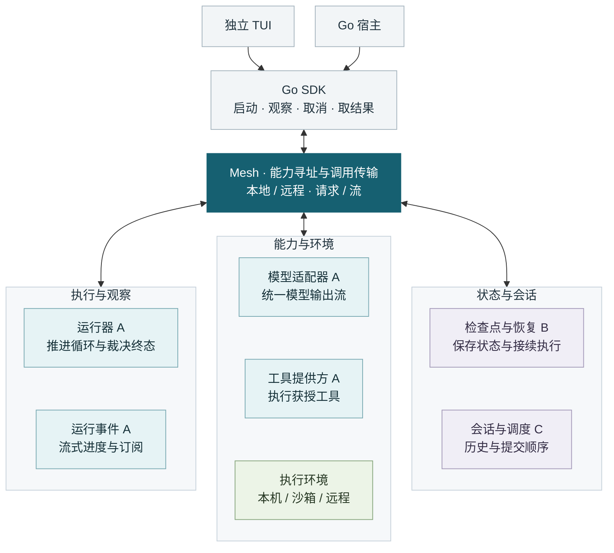
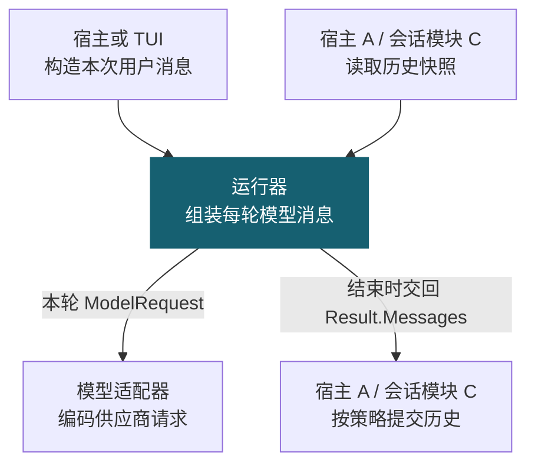
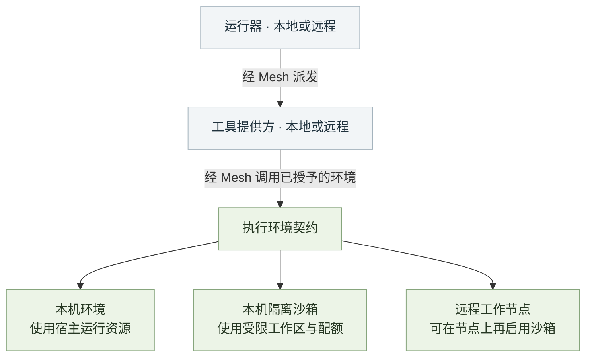

# SuperAgent 架构

设计评审稿。独立 TUI 和 Go SDK 共用 Go 执行内核。

## 组件如何连接

每个组件按契约独立接入 Mesh。Mesh 负责寻址和传输，运行器负责单次 Run 的状态与终态。阶段 A 使用进程内绑定。 [Mesh 传输图解](mesh-transport.md)

## 谁负责什么

| 职责 | 归属 |
| --- | --- |
| Loop 内的观察 | 运行器收集模型回复和工具结果，据此决定下一步 |
| 宿主观察进度 | 运行器发布有序事件，事件组件管理订阅和背压，宿主决定何时开始或停止观察 |
| 单次 Run 的预算 | 运行器检查额度并决定何时停止。模型和执行环境分别执行各自的资源上限 |
| 工具权限 | 宿主授予可用能力。运行器在派发前检查，工具提供方复核业务权限 |
| 统一派发工具 | 运行器发起调用，Mesh 负责传输，工具提供方执行并回传结果 |
| AI API 工厂 | 模型侧装配客户端，模型适配器封装供应商请求和响应 |
| 读写会话历史 | 阶段 A 由宿主负责，阶段 C 由会话模块负责 |

## 消息由谁构造

每轮模型消息由历史快照、本次用户输入及当前 Run 已提交的轮次组成。工具调用和结果齐全后才一起加入上下文。 [消息组装图解](message-assembly.md)

## 工作在哪里执行

当前交付使用进程内运行器和本机只读环境。远程工具通过 mTLS 接入，并在提供方侧访问工作区。图中的沙箱、远程运行器和远程执行环境是后续绑定位置。工具按次领用环境权限。 [执行环境图解](execution-environment.md) · [工具调用与回执图解](tool-call-lifecycle.md)

## 阶段与取舍

| 阶段 | 边界 |
| --- | --- |
| A · 单次执行 | 先做 bypass。用本地 Run 验证模型流、工具、权限、预算和终态。 [最小闭环图解](stage-a-acceptance.md) |
| B · 恢复 | 定义检查点和中断恢复。外部操作结果不明时，先查回执或等待确认 |
| C · 会话与调度 | 管理历史读写、历史快照和提交顺序。建议同一会话先允许一个活跃 Run |

并发验收用两路独立对话。甲在等慢工具时，乙可以开始回复。取消甲后，乙继续输出。

[详细架构与 Mesh 契约](../specs/architecture.md) · [Go SDK 图解](go-sdk.md)
