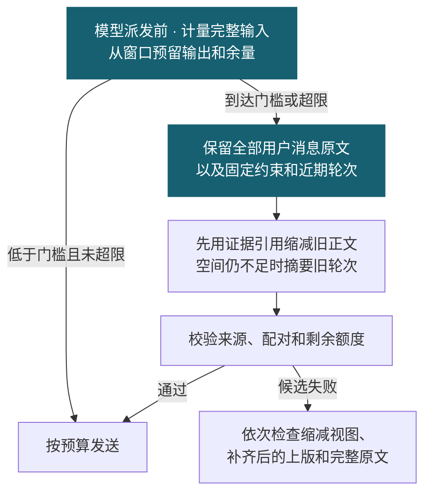

# 上下文什么时候压缩

阶段 A 基线由宿主在启动前选择完整历史轮次。以下是后续可选的 Run 内压缩设计。

首轮试验在可用输入窗口的 **90%** 触发，目标压到 **70%**。窗口先扣掉实际输出预留和计量余量，还要满足 Run 的输入字节预算。阈值按模型和长任务验收校准。

例如，一个工具轮次里写了两份文件，工具声明和两个结果一起保留或一起归入摘要。可找回的产物用引用保留证据，未知的工具结果仍由 Run 的原规则收尾。宿主从 `Wait` 取得的仍是原始已提交消息。

适配器发送前核对计量指纹。源引用经授权可按页回查；连续压缩时，用户消息的原文和顺序都保留。回退到上版视图时，运行器先补齐新提交的消息，再复核来源和剩余额度。

[接口与验收用例](../specs/context-compaction-contract.md) · [触发参数、算法和调研依据](../specs/context-compaction.md) · [消息组装图解](message-assembly.md)
