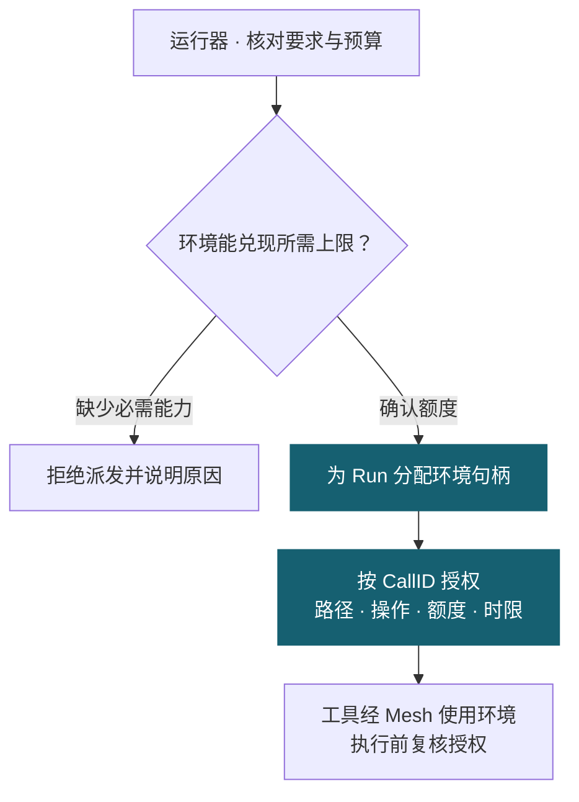
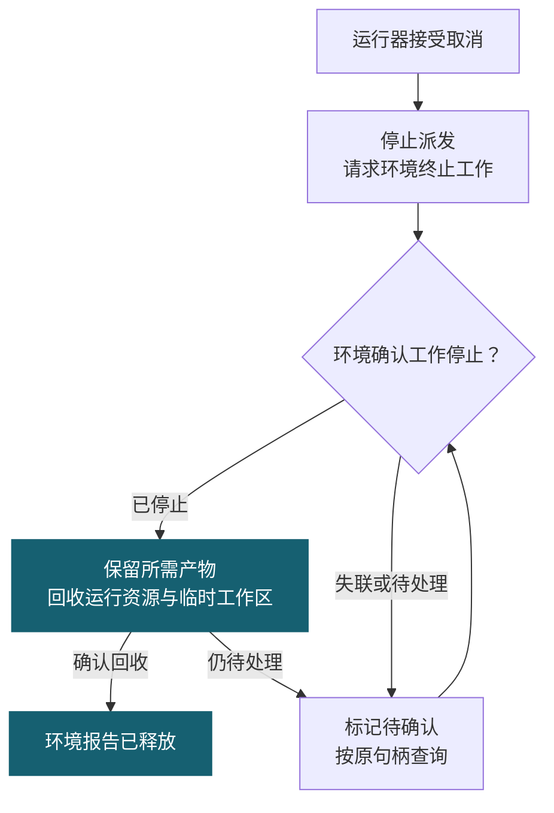

# 执行环境图解

需要工作区的 Run 绑定一个受限环境句柄。工具按次获得授权，可以在同一个工作区各做获准的操作。

## 从能力声明到执行

| 环境 | 声明与执行 |
| --- | --- |
| 本机 | 以宿主实测能力为准。进程内工具用有界读写，通用命令要求可验证的整组进程限制 |
| 沙箱 | 分别声明隔离范围、内存、时限和磁盘额度，配置完成后启动工作负载 |
| 远程节点 | 执行节点确认生效上限并负责执行。断开连接后，节点仍按已接受的时限收尾 |

## 取消后如何收尾

- 句柄和调用授权随 Run 收尾失效。后续 Run 使用同一工作区时重新授权。
- 临时工作区按策略回收。已有工作区、已发布产物各按其保留期管理，部分产物标明未完成。
- `Wait` 可以先返回 Run 终态，资源是否释放由环境单独确认。

[执行环境详细契约](../specs/execution-environment.md) · [工具调用与回执](tool-call-lifecycle.md)
