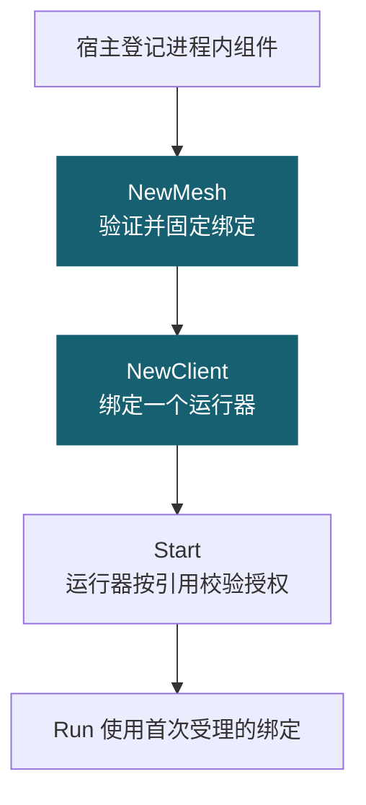
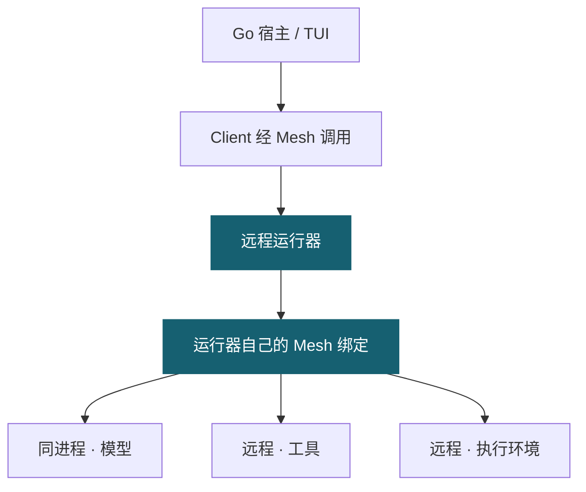

# Go SDK 宿主装配

## 从登记到运行

| 登记项 | 对应内容 |
| --- | --- |
| 模型 | `ModelRef` 和装配好的模型适配器，供应商客户端可复用。 [模型工厂图解](model-factory.md) |
| 工具 | `ToolRef`、工具声明和实现 |
| 执行环境 | `EnvironmentRef` 和可兑现的执行能力 |

运行器只接入本次 Run 获准使用的工具。使用工作区的工具在派发前再取得按次环境授权。

## 后续混合部署示例

远程运行器用它所在进程的 Mesh 找组件。将工具移到独立进程时，保留相同 `ToolRef`，更新 Mesh 绑定。

[装配详细契约](../specs/go-sdk-assembly.md) · [Mesh 传输图解](mesh-transport.md) · [Go SDK 图解](go-sdk.md)
