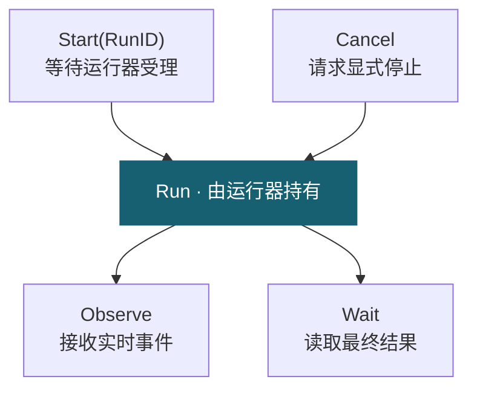
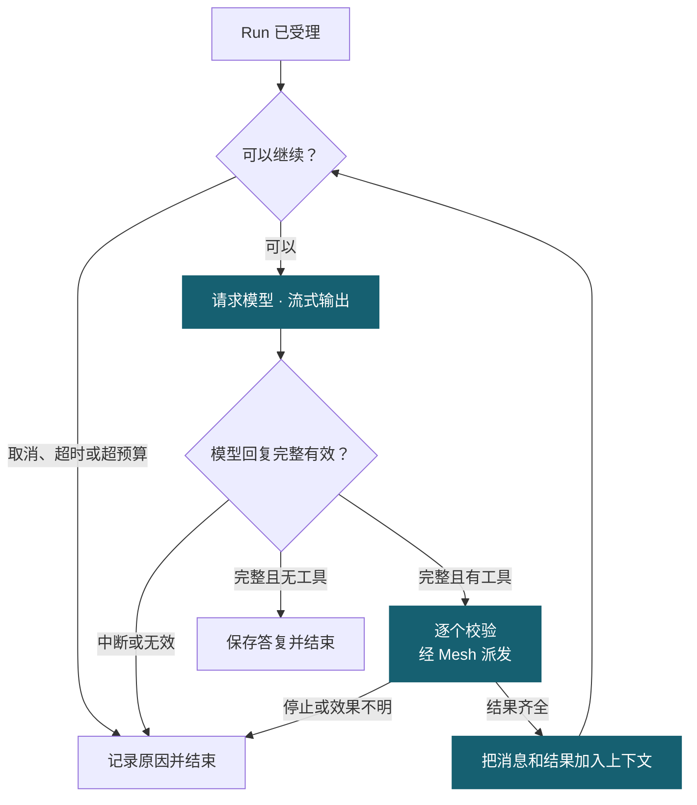
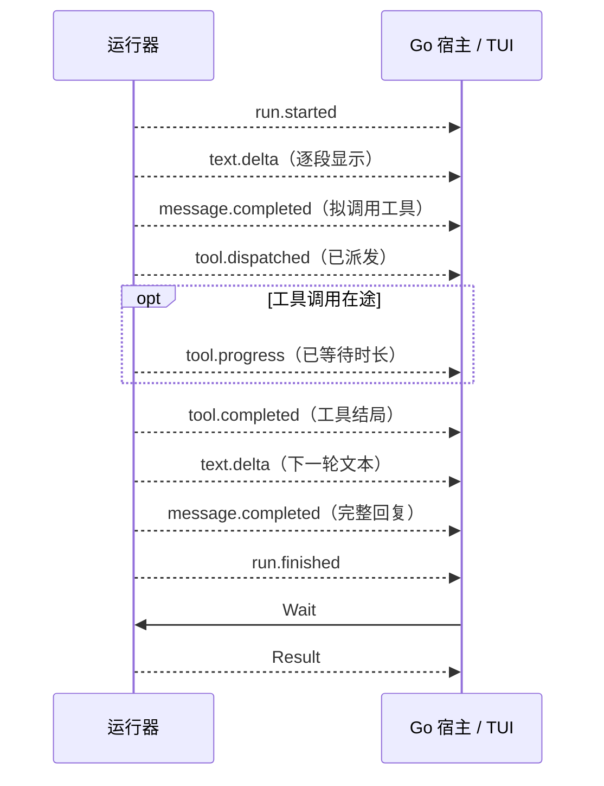

# Go SDK 图解

阶段 A 评审稿。Go 宿主和 TUI 使用同一套接口，经 Mesh 调用进程内运行器。 [宿主装配图解](go-sdk-assembly.md)

## 一次 Run 的生命周期

## Agent Loop

运行器从受理开始独立推进 Agent Loop。`Start` 返回 Run 句柄，宿主可以观察、等待或取消。一次 Run 可以往返调用模型和工具多轮。

可回传的工具失败或拒绝也计入本轮结果，模型可据此调整。每次派发前都会复查取消和预算。在途工具随 Run 接收取消信号，效果不明时按结果不明收尾。 [阶段 A 推进规则](../specs/stage-a-bypass.md#推进规则) · [Run 预算图解](run-budget.md)

模型流显式交付完整回复。此前的增量供界面显示，运行器接受完整回复后才处理拟调用的工具。 [模型流契约](../specs/model-adapter.md) · [上下文与消息组装图解](message-assembly.md)

## 三项取舍

| 建议 | 调用方看到的行为 |
| --- | --- |
| Run 独立于连接 | 启动受理后由运行器推进。关掉 TUI 视图或断开观察，Run 继续执行。`Cancel` 确认请求，终态仍从 `Wait` 取得 |
| 调用方预先生成 `RunID` | 启动结果不明时可用原 ID 查询或取消。同一运行器实例在记录保留期内对相同请求去重 |
| 实时事件有界 | `Observe` 供界面展示，慢消费时可能断流。`Wait` 返回权威终态，宿主用结果里的完整消息增量更新历史 |

## 事件示例 · 先用工具，再回复

- **完整回复替换草稿。** 参考 Claude Code 的增量和完整内容边界，界面以每轮完整消息收束流式文本。 [Claude Code 对标表](../specs/go-sdk-contract.md#claude-code-对标)
- **拟调用、已派发、已有结果各自可见。** 同一次工具调用用 `CallID` 串起来。派发后效果不明时，Run 以结果不明结束。
- **查看最终状态用 `Wait`。** 观察流断开后，宿主仍可读取原 Run 的结果。

模型和工具通过可替换接口接入。工具按次获得执行环境授权。 [权限门禁图解](run-authorization.md) · [执行环境图解](execution-environment.md)

[详细契约与 Go 接口签名](../specs/go-sdk-contract.md) · [架构图解](architecture.md)
