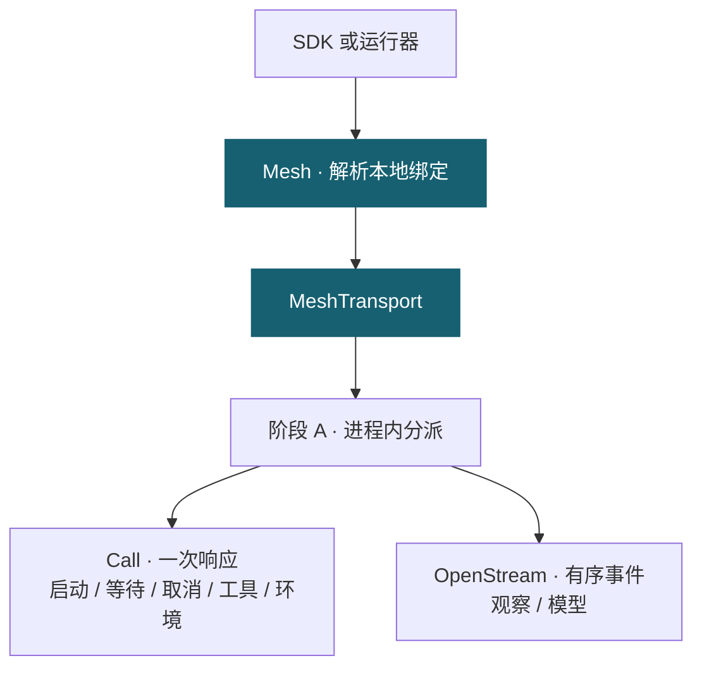

# Mesh 传输图解

阶段 A 先交付进程内调用。Mesh 用同一个传输接口承接普通请求和流，供以后接入远程传输。

| 情况 | 对 Run 的影响 |
| --- | --- |
| 关掉观察或等待超时 | 结束对应调用，Run 继续 |
| 显式取消 | 运行器停止新派发，并向在途工作传递取消。终态由 `Wait` 确认 |
| 模型流提前结束 | 本轮按失败或 Run 的停止原因收尾 |
| 工具可能已收到请求，回包却丢失 | 依据现有证据记录结果不明 |

本地配置用逻辑引用找到已登记实现，例如 `search` 绑定 `bounded-search`。绑定在构造 Mesh 时校验并固定。 [传输契约与 YAML 样例](../specs/mesh-transport.md) · [宿主装配](go-sdk-assembly.md)
