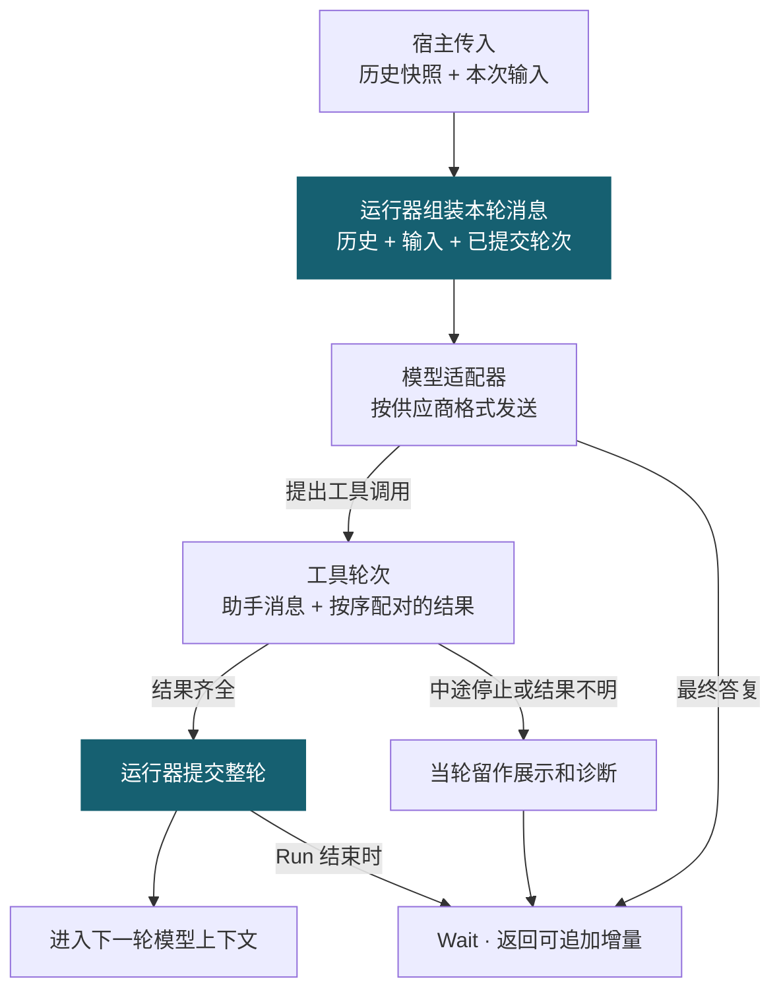

# 上下文与消息组装

宿主单独传指令和本次输入。历史按完整轮次选取，运行器在受理时固定快照。模型每轮看到同一份历史、本次输入和本 Run 已提交的轮次。

| 场景 | 哪些消息可以保存 |
| --- | --- |
| 模型生成最终答复 | 本次输入、已提交工具轮次、最终助手消息 |
| 同轮两个工具，一个成功、一个明确拒绝 | 两个结果都齐了，整轮可一起保存 |
| 同轮一个工具完成，另一个效果不明 | 本次输入和此前已提交的轮次。当轮执行结局随事件和终态报告 |

宿主按终态决定是否把 `Result.Messages` 追加到会话历史。该增量已包含本次输入及可用的最终答复，重复读取 `Wait` 时按 `RunID` 去重。

[历史、组装和提交契约](../specs/message-assembly.md) · [Agent Loop](go-sdk.md#agent-loop) · [上下文压缩设计](context-compaction.md)
