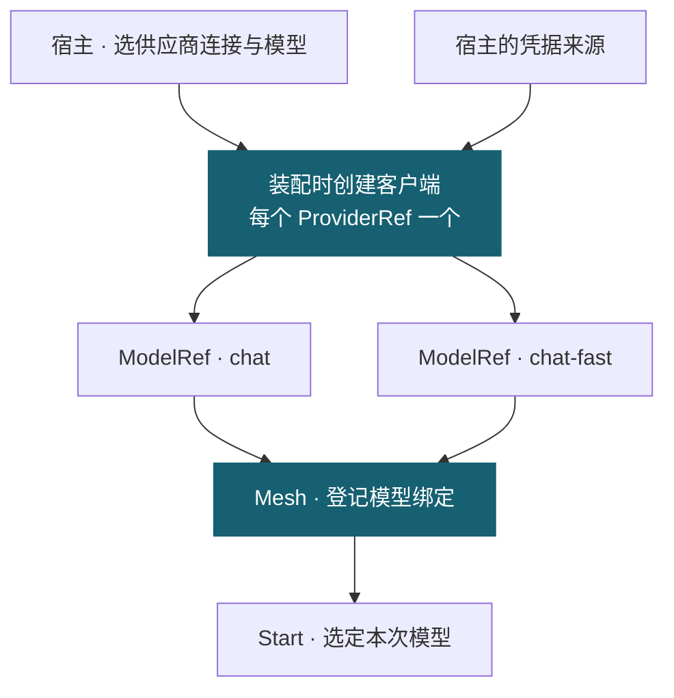

# 模型适配器工厂

多个 `ModelRef` 可指向同一供应商连接，复用客户端但各自选定供应商模型。每次模型请求有自己的流和取消范围。凭据由适配器侧客户端持有。

| 何时失败 | 从哪里看到 |
| --- | --- |
| 配置错误、凭据读不到或客户端构造失败 | 宿主在装配时收到错误 |
| Run 选择了未登记或未授权的模型 | `Start` 返回绑定或授权错误 |
| 供应商拒绝认证或请求连接失败 | 从 `Wait` 读取模型失败原因 |

更新配置或轮换凭据时，宿主构造新绑定供新 Run 使用，旧 Run 收尾后释放旧客户端。

[配置、生命周期与验收契约](../specs/model-factory.md) · [宿主装配图解](go-sdk-assembly.md)
