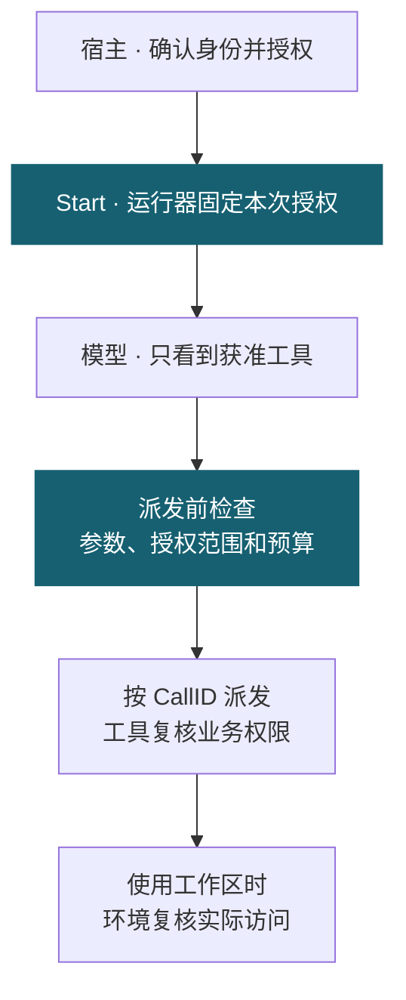

# bypass 权限门禁

宿主先授权，运行器在授权范围内自动执行。工具提供方复核业务规则，执行环境复核实际的资源访问。

例如，宿主给 `search` 的权限是读取 `docs/`。运行器检查搜索参数，环境检查实际打开的文件。即使路径看起来在 `docs/` 内，解析到目录外的文件仍会被拒绝。

| 失败点 | 宿主看到什么 |
| --- | --- |
| Run 申请了未授权能力 | `Start` 返回拒绝访问 |
| 运行器派发前拒绝 | `tool.completed(rejected)` |
| 派发后确认被拒 | `tool.completed(failed)`，回执区分未执行与已发生的效果 |
| 派发后无法确认效果 | Run 以 `ToolOutcomeUnknown` 收尾 |

已知的拒绝可回给模型缩小范围。取消生效后，运行器停止新派发并请求环境撤销在途授权。

[权限细则与验收场景](../specs/run-authorization.md) · [工具调用与回执](tool-call-lifecycle.md)
