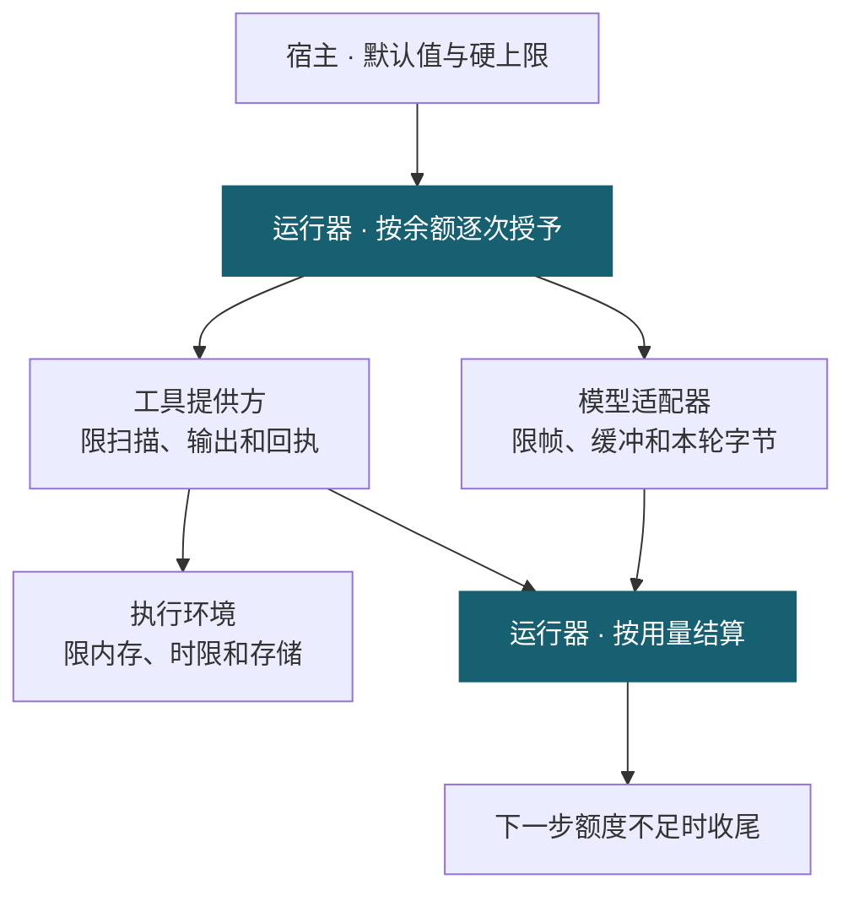

# Run 预算怎么用

模型输出和工具回执共用字节余额，每步最多领到剩余量和单次上限中的较小值。时间、调用次数、工作区扫描和原始输出各有自己的上限。

## grep 扫大文件

| 场景 | 达到上限后的动作 |
| --- | --- |
| 大文件一直无命中，或读到一条巨长的行 | 工具在读取或缓冲上限处停下，报告已扫字节和覆盖状态 |
| 命中太多，或者 stdout / stderr 持续输出 | 执行侧停止继续收集，只返回限长摘要、已确认命中或产物引用 |
| 通用命令吃满内存 | 执行环境回收整棵进程树。首版优先提供按块读取的有界搜索 |

工具已确认的限额结果可以交给模型缩小范围。Run 的额度不足以继续时，`Wait` 返回 `BudgetExceeded`。已派发工具的效果仍无法确认时，终态是 `ToolOutcomeUnknown`。

[预算分配、收尾与验收](../specs/run-budget.md) · [工具生命周期](tool-call-lifecycle.md)
