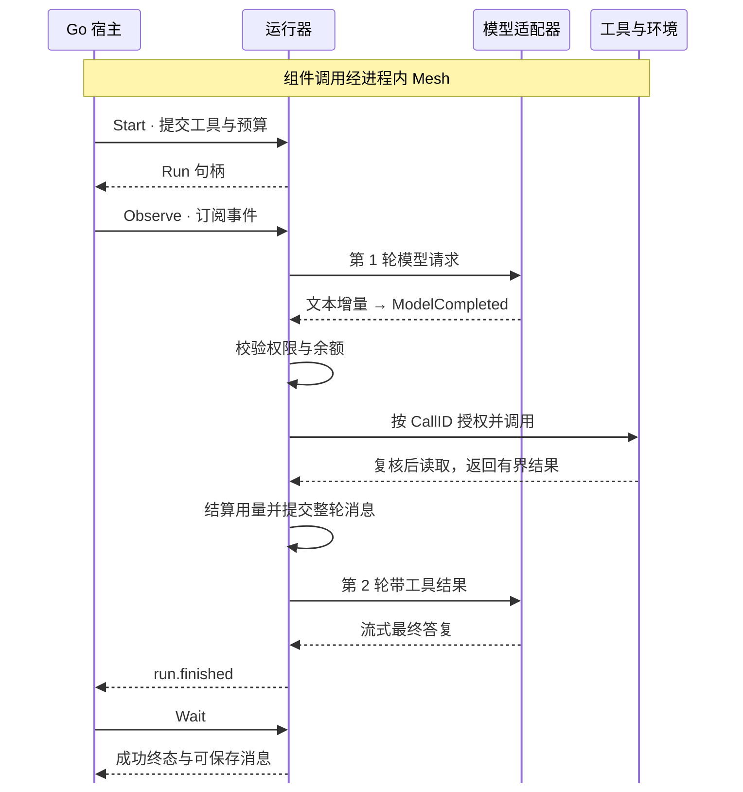

# 阶段 A 最小闭环

一次本地 Run 查询临时工作区中的 `status=ready`，用两轮模型和一次工具调用跑通宿主到执行环境的完整路径。

| 先后 | 做到什么才进入下一步 |
| --- | --- |
| 1. 纯文本 | 本地 SDK 能启动、观察、等待和取消 |
| 2. 工具闭环 | 完整回复后才派发，授权和预算均能拦截，结果配对进入下一轮 |
| 3. 故障验收 | 断流、取消、回执丢失和大文件各有可验证的结局，另一路 Run 可继续 |
| 4. 真实供应商 | 验证真实流、工具回传和错误映射 |
| 5. 上下文压缩 | 前四步通过后单独接入，按模型绑定验证计量、原文回查和回退后再启用 |

[实现顺序与端到端验收清单](../specs/stage-a-acceptance.md) · [阶段 A 边界](architecture.md#阶段与取舍)
