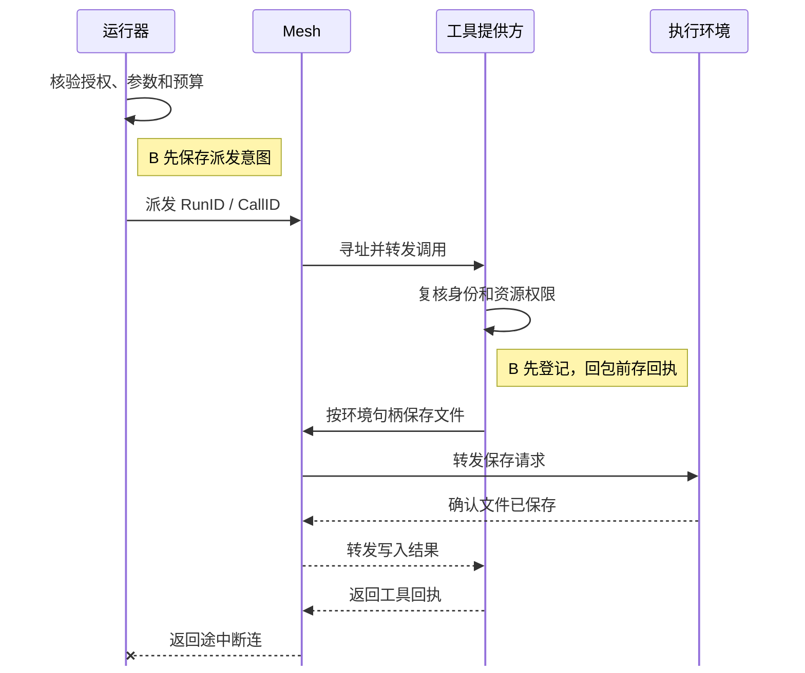
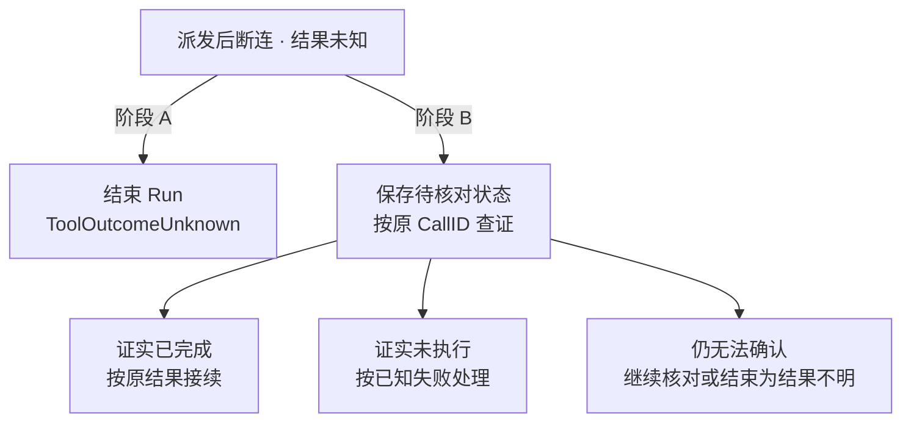

# 工具调用生命周期

设计评审稿。场景是远程工具把文件保存到可保留的工作区，执行成功的回执在返回途中丢失。

## 从授权到回执

运行器只看到断连。工具提供方及执行环境掌握各自能确认的执行事实。

## 回执丢失后怎么收尾

- **阶段 A** 在内存保留 Run 结果，结束后请求释放资源。工作区按原保留策略处理。
- **阶段 B** 从检查点恢复，按原 `CallID` 查证。建议先验收同机重启，多运行器接管随后验证。
- **大输出** 在执行侧分块写入产物。运行器接收有界的小结果或产物引用，检查点保存续跑所需的数据。
- **文件搜索** 同时限制扫描量、单行缓冲、工具内存和返回结果。扫到上限时，把已确认的命中和未扫完的状态一起返回。 [大文件搜索图解](run-budget.md#grep-扫大文件)

`Tool.Invoke` 的回执分为已知结果、明确未执行和结果不明。取消请求和资源释放独立确认。 [Go 请求与回执类型](../specs/tool-invoke.md)

[详细生命周期与验收场景](../specs/tool-call-lifecycle.md) · [架构图解](architecture.md)
