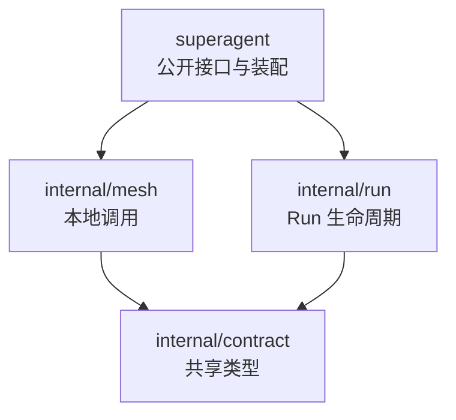

# 本地纯文本 Run 设计

## Context

当前仓库已有阶段 A 的契约文档，Go module 和运行器从本切片建立。行为以 [Run 生命周期规格](specs/run-lifecycle/spec.md) 为准。 [提案](proposal.md) · [SDK 契约](../../../../docs/specs/go-sdk-contract.md)

## Goals / Non-Goals

- **Goals** 用一次进程内模型请求验证宿主入口、流和终态。所有模型调用与 Run 控制都经过本地 Mesh。
- **Non-Goals** 工具循环、环境、真实供应商和压缩分别走 [后续切片](../../../../docs/specs/stage-a-acceptance.md#实现顺序)。

## Decisions

### Go module 和包

拟用 `github.com/shubolab/superagent`，与仓库 origin 一致。本切片以 Go 1.24 和标准库为基线。

| 包 | 职责 |
| --- | --- |
| 根包 `superagent` | 宿主装配、公开 `Client` 和 `Run`，暴露公共 DTO 的类型别名 |
| `internal/contract` | 共享的 ID、消息、模型流、事件和结果类型 |
| `internal/mesh` | 本地登记、绑定选择、可信调用者上下文、普通请求和流转发 |
| `internal/run` | 受理、去重、输入快照、预算、事件缓冲、取消和终态 |



根包装配运行器入口和模型流回调。回调由本地 Mesh 转发 `OpenStream`，运行器和 Mesh 在包层面各自依赖共享类型。这样公共 DTO 只有一份，宿主用根包类型就能实现模型接口。可控模型留在外部包测试中，通过公开入口注入。

### 最小宿主接口

```go
func NewMesh(cfg MeshConfig) (*Mesh, error)
func NewClient(mesh *Mesh, runner RunnerRef) (*Client, error)

func (c *Client) Start(ctx context.Context, req StartRequest) (*Run, error)
func (c *Client) Run(id RunID) *Run
func (r *Run) ID() RunID
func (r *Run) Observe(ctx context.Context) (EventStream, error)
func (r *Run) Wait(ctx context.Context) (Result, error)
func (r *Run) Cancel(ctx context.Context) error

type EventStream interface {
    Recv() (Event, error)
    Close() error
}

type RunID string
type RunnerRef string
type ModelRef string
type SubjectID string

type MeshConfig struct {
    LocalRunners  map[RunnerRef]RunnerConfig
    LocalModels   map[ModelRef]ModelProvider
    ResolveCaller func(context.Context) (SubjectID, error)
}

type RunnerConfig struct {
    AllowedModels      map[SubjectID][]ModelRef
    DefaultBudget      Budget
    BudgetCaps         Budget
    ObserveBufferBytes uint64
    ResultRetention    time.Duration
}

type StartRequest struct {
    ID          RunID
    Model       ModelRef
    Instruction string
    History     []Message
    Input       UserMessage
    Budget      Budget
}

type Budget struct {
    Timeout            *time.Duration
    MaxModelRequests   *uint64
    MaxModelInputBytes *uint64
    MaxOutputBytes     *uint64
}
```

宿主通过 `ResolveCaller` 从受信上下文提供已验证主体。装配校验并固定登记表、`AllowedModels` 和有效配置。默认及封顶预算每项须为正数，默认值在封顶内。请求的空字段采用宿主默认值，显式非正数拒绝，正数按宿主上限收紧。 [Run 授权](../../../../docs/specs/run-authorization.md) · [预算](../../../../docs/specs/run-budget.md)

### 模型与 Mesh 最小接口

```go
type ModelProvider interface {
    Generate(ctx context.Context, req ModelRequest) (ModelStream, error)
}

type ModelStream interface {
    Recv() (ModelEvent, error)
    Close() error
}

type MeshTransport interface {
    Call(ctx context.Context, req MeshRequest) (MeshReply, error)
    OpenStream(ctx context.Context, req MeshRequest) (MeshStream, error)
}

type MeshStream interface {
    Recv() (MeshFrame, error)
    Close() error
}
```

| 契约 | 本切片使用的字段及路由 |
| --- | --- |
| 模型请求 | `RunID`、`Step=1`、`Model`、`Instruction`、按序 `Messages`、`MaxOutputBytes`。历史使用用户和助手文本 |
| 模型事件 | `ModelTextDelta` 和 `ModelCompleted`。完成回复提供 `Finish`、完整文本和可得用量。纯文本成功的结束原因是 `stop` |
| SDK 事件和结果 | `Event` 提供 `RunID`、`Seq`、`Step`、种类及对应负载。`Result` 提供终态、答复、消息增量、可得用量和停止详情 |
| Mesh 路由 | `Call` 承载 `Start`、`Wait`、`Cancel`。`OpenStream` 承载 `Observe` 和模型流。保留类型、身份、截止和流错误 |

消息、事件和计量规则沿用阶段 A 的现有契约。 [消息契约](../../../../docs/specs/message-assembly.md) · [模型流契约](../../../../docs/specs/model-adapter.md) · [Mesh 契约](../../../../docs/specs/mesh-transport.md)

### Run 状态与验收控制点

- **受理。** 运行器以主体和 `RunID` 查找同一实例内的记录，比较请求快照。受理完成后用独立 Run 上下文执行。模型调用前按规范输入字节计量，模型流接收处复核输出。
- **观察。** 受理起保留按字节计量的事件前缀，供一次订阅。通过有界队列交付，溢出时保留已缓冲前缀并结束观察。观察读取和终态读取独立。
- **停止。** 运行器串行裁决取消、截止和模型完成。提交结果后发布唯一终态事件。模型 `Close` 可解阻读取，`Wait` 返回独立快照。
- **可控模型。** 用屏障暂停模型完成、释放增量、注入 EOF 和确认取消。由测试推进到期与停读的顺序，并核对请求次数、事件、终态和流关闭。

## Risks / Trade-offs

- 快速完成可能早于订阅 → 从受理时缓冲，使用有限容量及保留窗口。
- 模型终止和取消可能竞争 → 用已裁决的提交边界确定终态，分别验收两种先后。
- UTF-8 输出和完成快照可能重复计量 → 用“你”“好”及完整答复检查六字节达限和五字节越界。
