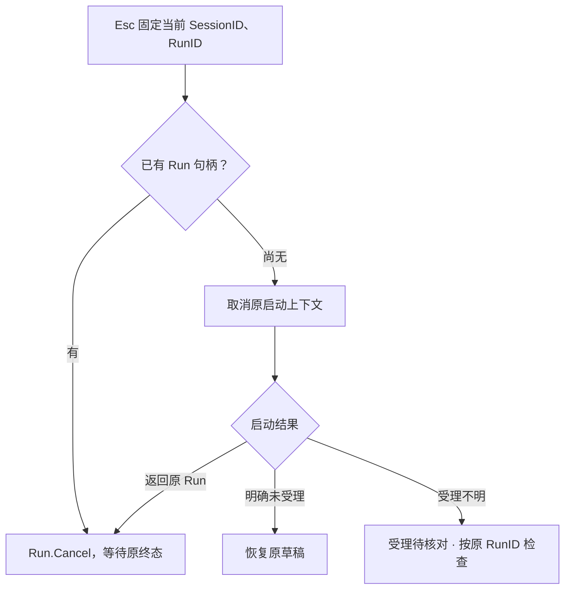

# 最小 TUI · 双会话设计

## Context

调度器负责排队与授予。现有 `Session.Start` 只交付最终受理结果，`PendingRun` 只读持久预约。运行器的 `Observe` 每个 Run 可用一次。 [本地调度](../../../specs/local-session-scheduling/spec.md) · [Run 生命周期](../../../specs/run-lifecycle/spec.md)

## Goals / Non-Goals

一个本地终端进程，通过 SDK 打开宿主指定的两个 `SessionID`。只做键盘切换、单行发送、流和排队展示、取消当前请求。会话创建管理、退出时的运行策略、跨进程界面恢复和终端框架选型各自评审。

## Decisions

### 布局与操作

```text
[甲 · 运行中]   乙 · 排队中

甲的当前对话与流式预览

> 当前会话的输入
Tab 切换   Enter 发送   Esc 取消当前
```

`Tab` 只切换当前会话。终端以 `SessionID` 分别保存历史窗口、草稿、当前 `RunID` 和状态。初始历史从 `Session.Snapshot` 读取。发送后保留本次输入，直到受理结论确认。明确未受理时恢复草稿。忙时重复发送只保留原请求。

### SDK 与视图

新增可选入口 `Session.StartWithProgress(ctx, request)`，返回只读的受理通知通道。请求在交回通道前固定。通知含 `RunID`，每次最多三条，分别为实际入队（可选）、取得名额（可选）、原启动结果。结果后关闭通道。调度锁外交付，缓慢消费也能保留顺序。原 `Session.Start` 复用同一受理路径。

| 来源 | 视图更新 |
| --- | --- |
| 发送、调度入队、授予、受理返回句柄 | 依次映射到启动中、排队中、受理中、运行中。立即授予跳过排队中 |
| `Observe` 的 `text.delta` 和完整消息 | 按 Run、轮次和事件序号累积预览。完整消息替换该轮预览。切换时后台继续收取 |
| `Wait` 和 `CommitRun` | `Wait` 固定终态和确认消息，收束本次预览。用独立上下文按原 `RunID` 保存，成功后以会话历史为准 |

每个已受理 Run 启动一个观察消费者，另外独立等待终态。使用有界预览，截断时提示。观察溢出或断开时保留已有预览，继续等待完整结果。历史只追加确认的消息增量。保存失败显示待保存，此时 `Enter` 重试原 `RunID` 的保存。 [会话历史](../../../specs/session-history/spec.md)

### 取消与交接



取消命令和异步结果都以固定的会话、`RunID` 交回界面。后续切换只影响显示。同一取消处理中重复按 `Esc` 共用原操作。受理与取消竞争时，如原 Run 已存在，使用独立于启动上下文的取消调用，最终状态由 `Wait` 确认。受理结果不明时可用原标识查询或取消已有 Run，避免通过 `Start` 或会续跑的 `Recover` 产生新派发。旧进度无法覆盖该 Run 的取消状态、终态或更新的请求。

## Risks / Trade-offs

| 情形 | 处理 |
| --- | --- |
| 受理归属暂时无法核实 | 保持「受理待核对」，另一个会话照常操作 |
| 观察来不及消费 | 以有界预览继续渲染，独立读取 `Wait` 并以可信终态收束 |
