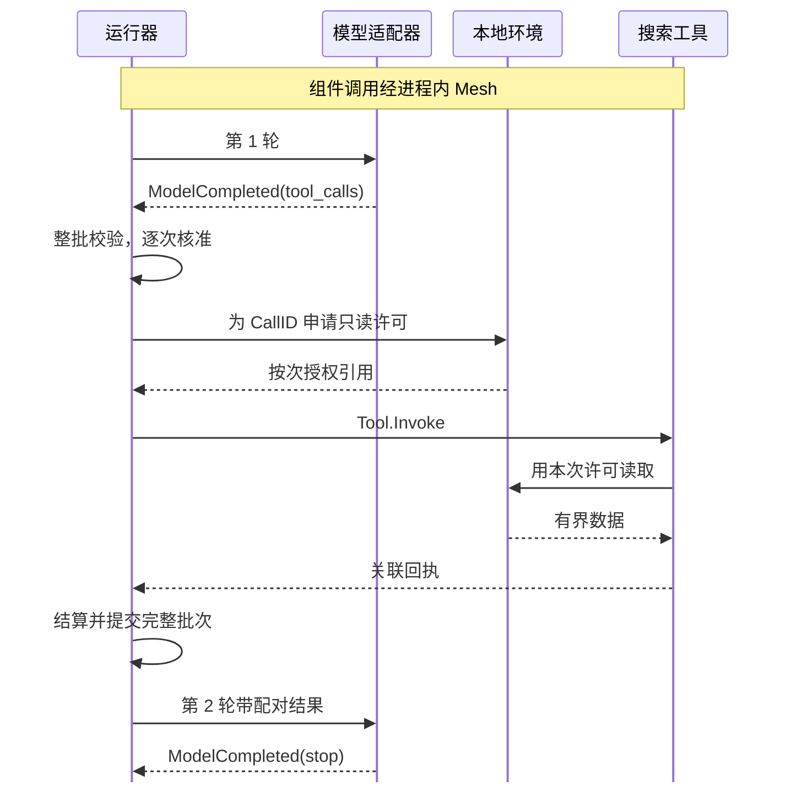

# 本地有界搜索闭环设计

## Context

当前 `runner/model.go` 一次只推进一轮纯文本，完整回复直接提交终态。Mesh 已有普通请求和流入口。本切片复用这些入口，加上串行工具批次、文件读取授权及逐步预算。 [提案](proposal.md)

## Goals / Non-Goals

- **Goals** 用真实的本地文件和可控模型验证两轮模型、一次搜索及一个终态，也验收同轮多个调用的配对和提交。
- **Non-Goals** 目录递归、正则、通用命令、跨进程传输、写入恢复、真实供应商和压缩各自留给后续切片。

## Decisions

### 本地包与边界

| 位置 | 增量 |
| --- | --- |
| 根包与 `internal/contract` | 扩展 `MeshConfig` 的工具和环境登记，以及 `StartRequest` 的 `Tools`、`Environment`。加入 `ToolSpec`、`Tool.Invoke`、`ToolResult`、模型工具声明和 SDK 工具事件 |
| `mesh` | 沿用 `OpenStream` 调模型。用类型化 `Call` 承载工具调用和环境的分配、授权、打开、撤销与释放 |
| `runner` | 将模型推进改为逐轮，唯一持有 Run 预算、顺序、停止裁决及消息提交 |
| `internal/environment`、`internal/search` | 环境持有目录能力与授权，搜索只消费受限读取流并产生有界回执。根包按现有依赖方向接入 |

入口和回执使用现有 [Tool.Invoke 契约](../../../docs/specs/tool-invoke.md)。读取接口提供可取消、可关闭的受限流。工具拿到的工作区访问入口只识别它的按次授权，环境对每次打开复核并限制后续读取。

Run 额度增加 `MaxToolRequests` 和 `MaxToolScanBytes`。宿主的工具单次上限和环境实际可兑现的额度共同收紧 `ToolLimits`。此搜索的回执是模型可见输出。

### 从模型回到模型

运行器先检查完成原因、批内及 Run 内的调用 ID、工具名称和参数是否为完整 JSON 对象，再发布 `message.completed`。具体工具的参数约束和权限逐次复核。每个调用预留回执额度、取得授权并在派发边界复查停止条件。成功、明确拒绝和已知失败都可以形成配对消息。未知回执阻止整批提交，运行器保留此前已提交的消息。 [Run 生命周期增量](specs/run-lifecycle/spec.md)

### 授权与搜索范围

- 宿主将受控工作区的获准目录登记为只读能力，例如工作区内的 `docs/`。许可绑定当前主体、运行器、Run、调用、工具、工作区、路径、额度及截止时间。
- 环境用固定许可目录的根句柄约束实际打开。Go 1.24 的 `os.Root` 可用来锚定目录边界。环境还要拒绝特殊文件，并在装配时拒绝无法兑现读取和截止约束的绑定。工具侧与环境侧各自核对身份和范围。
- `search` 首个契约接收 `path` 和 `query`。路径是工作区相对的单个普通文件，查询是非空、限长、区分大小写的单行字面文本。分块扫描，按实际读入计费。只有完整读取的行可判定命中，确认 EOF 的末行可参与匹配。
- 结果包含行号、限长预览、扫描量和 `complete` 或 `partial` 覆盖状态。扫描、单行、命中或结果上限提前停止时返回已确认的有界内容及原因。调用收尾时撤销许可，Run 终结时释放环境句柄。 [有界搜索增量](specs/bounded-file-search/spec.md) · [授权边界](../../../docs/specs/run-authorization.md)

### 预算与收尾

| 边界 | 规则 |
| --- | --- |
| 模型 | 每轮扣模型次数和实际请求输入字节，授予共享输出余额内的本轮上限。文本增量与重复的完成快照只计一次，工具声明计入规范模型输出 |
| Tool.Invoke | 有效拟调用进入校验即扣一次。按 Run、单次和环境限额取小授予 `MaxScanBytes` 和 `MaxResultBytes`。派发及生成拒绝结果前给最小关联回执留空间 |
| 工具完成 | 按可验证的扫描用量结算，把包括元数据和拒绝原因在内的完整有界回执计入共享输出。缺少可信计量时按所授额度结算 |
| 停止边界 | 取消先记录意图，再停止新调用并撤销授权。已越过派发边界的调用在有界期限内确认回执，未知结果按 `ToolOutcomeUnknown` 收尾。资源清理用独立有界上下文 |

### 固定验收数据

沿用 [阶段 A 的固定 Run](../../../docs/specs/stage-a-acceptance.md#固定的本地-run)，文件 `docs/health.txt` 内容为 `status=ready\n`，模型声明 `c1` 搜索 `status`。模型请求额度 2 次，工具尝试额度 1 次，扫描额度 32 字节。真实读取 13 字节，第二轮必须收到配对结果。测试替身在完整回复、授权、派发和回执边界暂停，通过公开 SDK 核对事件、实际读数、预算和终态。

## Risks / Trade-offs

- 恶意路径通过字符串前缀检查 → 由环境以许可目录约束实际打开，验证越界链接和复用授权。
- 大文件读取在命中前耗尽资源 → 独立限制字节、单行和回执，验收零命中及超长行。
- 当前取消可直接提交纯文本终态 → 工具在途时先确认结局，再提交稳定终态。纯文本路径继续按已归档用例验收。
