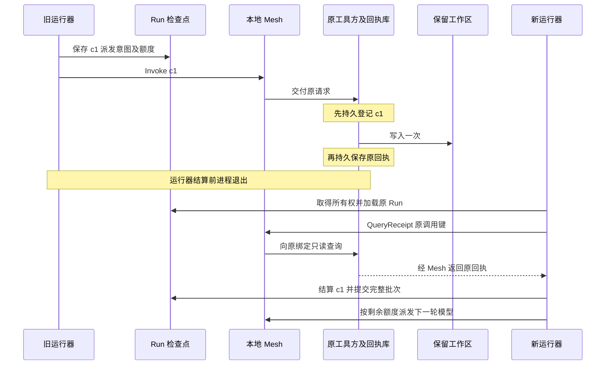

# 阶段 B 首步 · 本地进程重启恢复

## Context

阶段 A 以运行器内存为推进状态。首步由同一宿主启动新进程，沿用本地 Mesh 和保留的工作区。适用于显式开启恢复、使用支持原回执查询的本地工具的 Run。

[工具调用生命周期](../../../docs/specs/tool-call-lifecycle.md#阶段-b-恢复) · [消息组装](../../../docs/specs/message-assembly.md) · [环境保留](../../../docs/specs/execution-environment.md#工作区和产物保留)

## Decisions

### 检查点推进边界

检查点属于运行器。宿主配置本地持久存储与核对时限，使用原身份和 `RunID` 显式恢复。新进程核验逻辑运行器、主体和记录格式，取得本地独占权后推进。未终结的 Run 还需校验原绑定身份及版本。重复恢复复用同一推进。首次执行和恢复均须持有独占权，进程退出后才能由新进程取得。

| 保存时点 | 一起保存的最小状态 | 进程重启后的起点 |
| --- | --- | --- |
| 启动受理前 | 原身份和 Run 标识、输入与历史快照、绑定版本、工作区、原授权范围、预算及绝对截止时间 | 首个模型步骤 |
| 每次模型派发前 | 步号、模型派发意图、派发所需账本扣减及预留 | 该步若尚未提交完成回复，按模型步骤中断收尾 |
| 接受完整的 `ModelCompleted(tool_calls)` 后 | 助手声明、按原顺序记录的工具参数及 `CallID`、本次模型结算 | 首个有待处理的调用。没有派发意图时从派发前门禁继续 |
| 每次工具送入 Mesh 前 | 原调用键、规范请求参数指纹、授权上限、环境引用、工具预算预留 | 有意图而未结算时，只查原回执 |
| 工具结果可核验时 | 有界结果、该 `CallID` 对应的结算；派发前拒绝也落为可关联结果 | 复用已结算结果，检查下一个调用或提交齐备的批次 |
| 轮次完整或 Run 收尾时 | 工具批次与下一步位置；或已裁决的终态、最终答复及消息增量 | 进入下一轮，或直接返回已保存的终态 |

每行是一个提交边界。存储确认成功后才跨越相应边界。提交结果不明时停止推进，重开后以最后一份完整记录裁决。保存终态后才让 `Wait` 返回。已提交的取消在重启后继续生效。

### 通过原工具方核对

查询键包含可信主体、逻辑运行器、`RunID`、`Step`、`CallID`、工具绑定及版本、工作区身份及所需版本、规范请求指纹。Mesh 按原绑定路由。工具方核验读取权限及请求归属，查询路径只读取原回执库。回执包括已知成功、已知失败或能保证原尝试无法再生效的明确未执行，以及结算所需用量。工具方在同一调用键下只允许一次执行登记，重复请求返回原状态，指纹不符时报冲突。

查无记录、仍在途、不可用或身份不符都保持待核对。保存动作与工具回执是两次独立写入。首步仅使用工具方保存的可信回执作为核对证据。工作区当前的文件内容不足以证明原调用结局。

### 停止与续跑

- 首次进入待核对时提交绝对核对期限，取宿主配置的有限窗口和原 Run 截止时间中较早者。窗口内以有界频率和单次查询时限核对。再次重启沿用原期限。
- 结算可信回执与账本后，按原顺序推进。首个仍无派发意图的调用重新取得按次授权，有效范围取原授权与当前允许范围的交集。后续派发前确认原工作区可用，旧执行已退出或无法继续写入。
- 未判定调用在核对截止或取消后以 `ToolOutcomeUnknown` 结束，记录原 `CallID` 和停止原因。当轮消息只在声明和全量配对结果齐备并获准提交时进入历史。无法核实的原调用用量按已有预留保守结算。
- 已知工具结局和环境清理分别记录。仅工作区不可续用时保留有效回执。Run 达到原截止按 `TimedOut` 收尾。宿主窗口先到且所需工作区仍不可续用时，按工作区不可用原因返回 `Failed`。需要等待环境的恢复复用同一绝对核对期限。

### 宿主入口与留存

宿主用原 Client 绑定、可信身份和 `RunID` 调用 `Recover`，拿到支持 `Wait` 和 `Cancel` 的句柄。恢复请求的上下文约束本次受理，`Wait` 上下文约束本次等待。受理后的 Run 由原期限与显式取消控制。同身份重送原 `Start` 只返回已存在的记录，相同标识搭配不同输入时报告冲突。

检查点和提供方回执至少保留到核对期限。终态按配置的 Run 保留期可读。持久记录保留有界结果、必要消息和稳定引用，环境句柄在后续派发时重新分配。旧流式预览、凭据、临时授权令牌和大产物正文留在各自原路径。大产物需由跨进程可读且带版本的引用定位。

首轮验收采用可控模型、同一台机器、同一逻辑运行器、保留工作区和随旧进程一同退出的工具执行。恢复验收从 `Wait` 读取结果，观察事件跨进程续接、上下文压缩状态恢复和多实例接管留待后续设计。

### 本地装配

- 在 `RunnerConfig.Recovery` 配置独立持久目录、绑定版本和核对窗口，使用 `StartRequest.Recoverable` 开启。macOS 与 Linux 使用进程退出时自动释放的文件锁。宿主变更绑定实现时更新版本。
- 工具方可用 `NewLocalReceiptTool` 为本机工具登记和保存原回执。工作区通过 `RecoveryWorkspace` 提供跨进程身份及旧写入已隔离的检查。本机读环境使用原工作目录身份，适用于旧工具执行随进程退出的场景。
- 产物引用依赖能在 `Complete` 后跨进程读取的宿主产物存储。每份检查点和回执最多 32 MiB，工具回执另受原调用额度限制。持久目录由宿主管理，Run 保留期控制终态可读时间。
