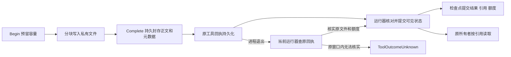

# 阶段 B · 持久产物发布与恢复

## Context

本地回执先于产物 `Settle` 持久化。现有恢复检查试读公开首字节，只能确认一个已可读的引用。真实绑定还需核对已封存但未发布的产物，并能接续原发布。 [现有存储](../../../../internal/artifact/local.go) · [B5 验收记录](../../../../docs/specs/stage-b-recovery-acceptance.md#b5--产物绑定)

## Goals / Non-Goals

范围是同一宿主的本地工具。覆盖进程重启及共享租约下的接管，每次调用发布一个产物。宿主选用 `NewLocalRetainedArtifactStore(LocalArtifactConfig)` 并通过 `MeshConfig.LocalArtifacts` 注册。绑定声明 `RetainsAcrossRestart` 和 `StagesUntilPublication`，继续使用现有写入和读取入口。

## Decisions

### 磁盘与发布

| 状态 | 记录与可见性 |
| --- | --- |
| 写入中 | 同一固定私有目录保存跨进程配额预留和暂存文件。按原授权分块写入，累计实际字节和摘要。暂存文件仅写入方可用 |
| 已封存 | 正文与校验块摘要已同步到磁盘，原子提交封存元数据。元数据绑定存储身份、主体、运行器、Run、原 `CallID`、请求指纹和接单代次，记录完整 `ArtifactRef`。`Complete` 返回后正文和版本固定，宿主读取仍不可查 |
| 已发布 | 已验证的工具回执选中该引用。`Settle` 原子切换可见状态。重复确认返回原引用和已确认字节数，原正文不复制、不重写 |

- 使用同一文件系统和既有本地持久化原语。正文、校验摘要先持久化，随后提交元数据状态并同步目录。进程退出后以可重读的持久状态判定，未关联的暂存文件不可见。
- 在目录内持久化存储身份和额度策略，在需要此绑定的 Run 检查点固定身份。重启拒绝不同身份或不兼容的装配。`Close` 释放本进程资源，持久目录由绑定的保留策略管理。
- 用跨进程锁串行化预留、状态变更和回收。正文写入和完整校验使用有界缓冲，在共享所有权锁之外执行。写入时计入预留上限，封存后按实际字节占用，同时受份数上限约束。正常撤销随结算清理。启动或新预留时清理已过期记录，进程崩溃留下的未完成暂存在原调用截止且写入者退出后回收。

### 读取与保留

- `ExpiresAt` 在 `Complete` 固定。可恢复 Run 取封存时间加配置 `Retention` 和原 Run 截止中的较晚者。重启、接管、重复发布和读取共用同一时刻，产物与 Run 终态的保留期独立。
- `Run.ReadArtifact` 通过 Mesh 验证原所有者和全部引用字段。单页长度取剩余字节、调用方 `maxBytes`、配置页上限的最小值。偏移大于长度或 `maxBytes=0` 时返回 `ErrArtifactUnavailable`，等于长度时返回空页及 `EOF=true`。
- 写入时计算整份 SHA-256 和固定 64 KiB 校验块摘要。分页最多读取并校验覆盖该页的两块，含尾块。摘要按块寻址，表的尺寸由产物上限约束。恢复时用有界流式扫描校验完整 SHA-256 和块摘要，复用到发布提交的同一文件版本。

### 恢复与异常

| 崩溃后看到的持久状态 | 当前运行器的操作 |
| --- | --- |
| 无匹配回执，或引用的产物不可核验 | 查询原调用。查证截止或取消时，按原调用提交 `ToolOutcomeUnknown`，未知用量按原预留结算 |
| 匹配回执和可核验的封存版本 | 确认最终回执编码含用量及引用后仍满足原回执上限。由当前所有者只发布这个版本，将实际产物字节和小回执分别入账 |
| 已发布，检查点仍待结算 | 接用同一份产物，完成一次持久结算 |
| 已结算，下一步仍依赖产物 | 续跑前核验待完成批次中的引用，以及下一轮直接接续的刚提交工具批次中的引用。不可用时停止依赖派发，保留原已知结算。失败原因使用 `recovery_artifact_unavailable`，已生效的取消或 Run 截止优先 |
| 已提交终态 | `Wait` 返回原结果。正文遗失、损坏或过期时，`ReadArtifact` 单独报告不可用 |

Mesh 在受信调用中交付原 `ReceiptKey`、期限和有效额度，由持久绑定记录，公开 `ArtifactRef` 的字段沿用现有契约。短请求限时用于查回执，收到回执后的本地流式核验使用原绝对核对期限的剩余时间。账本只在检查点结算时更新。

共享租约下，进入短发布事务时再次核对当前所有者、原已接单调用和已验证的封存版本。新代次可以确认旧代次的封存版本，旧代次无法封存或发布。回执查询保持只读。

## 真实绑定验收

使用真实构造器和私有磁盘目录，通过公开 SDK 启动写入进程和恢复进程。模型可控，产物存储使用待发布的本地持久绑定。以下用例记录进程、原引用、预算和派发次数。

| 用例 | 故障或边界 | 观察 |
| --- | --- | --- |
| B5.1 · 半成品与封存 | 分块中退出，或 `Complete` 后、回执落盘前退出 | 宿主无法读取。待核对的原调用按窗口收尾，回执为空时也不重发 |
| B5.2 · 回执和发布断点 | 分别在回执落盘后发布前、可见提交后结算前终止进程 | 重启使用同一引用，发布、工具执行及预算结算各一次。比较检查点与回执，确保正文仅在产物目录 |
| B5.3 · 分页和完整性 | 写入大于两块的确定数据，再重启。读取非对齐跨块页、末页和 EOF。分别读取错误主体、Run、被改写的引用及等长损坏的正文 | 拼接后长度和 SHA-256 与原引用一致。非法请求或受损页返回不可用，受损页交付字节为零 |
| B5.4 · 丢失和到期 | 待核对时移除正文或修改远离第一页的块。另在已结算且下一步依赖产物时移除正文，以及在终态提交后等到引用过期 | 分别验证 `ToolOutcomeUnknown`、保留原结算并停止依赖派发、以及仅读取失败而终态保持原值。原工具重发为零 |
| B5.5 · 接管与容量 | 旧进程仍活着，新进程接管后凭原回执发布。两个宿主进程以同一目录竞争配额，再回收过期记录 | 旧代次提交被拒，当前代次只发布同一版本。两进程共享总上限，回收保住活跃预留及未过期引用 |

## Risks / Trade-offs

- 完整恢复核验的 I/O 随产物大小增加，受原核对期限约束。固定块摘要使单页读取开销受页和块大小约束。
- 目录和内容在同一宿主的信任边界内。跨主机存储、远程工具产物传输和通用宿主回收策略沿各自部署规范设计。
