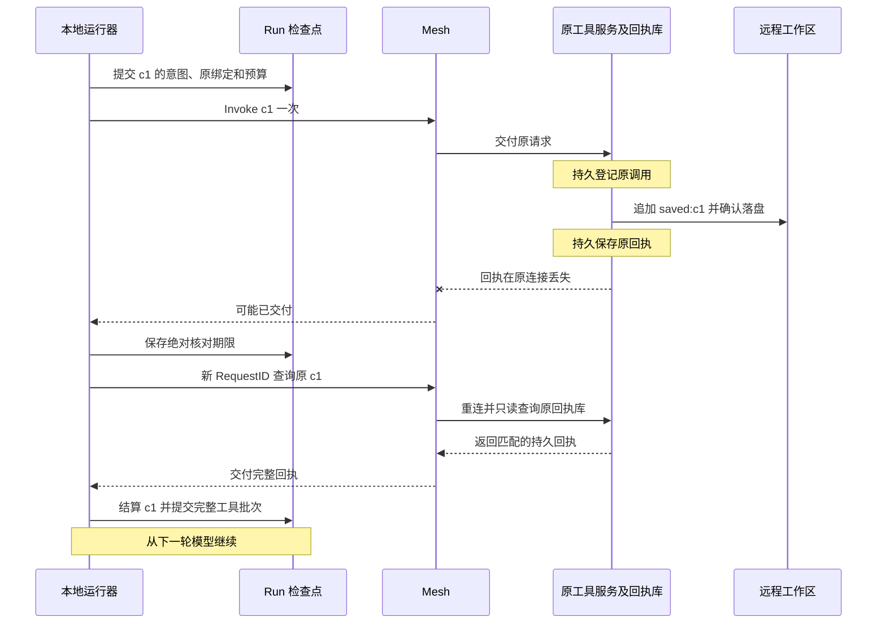

# 阶段 B · 远程工具回执恢复

## Context

本地恢复已有检查点、按原调用查询及有界核对。这一步让工具服务跨进程经 Mesh 执行，运行器、模型和检查点沿用本地装配。首轮只需要普通请求 `Invoke` 和 `QueryReceipt`，使用真实回环连接注入断连。

[恢复主规范](../../../specs/run-recovery/spec.md) · [Mesh 逻辑传输](../../../../docs/specs/mesh-transport.md) · [工具回执生命周期](../../../../docs/specs/tool-call-lifecycle.md#阶段-b-恢复)

## Decisions

### 原调用与查询

| 组件 | 保存或传递的证据 |
| --- | --- |
| 运行器 | 首次派发前原子保存工具意图和预算。意图包含主体、逻辑运行器、`RunID`、`Step`、`CallID`、提供方与回执库身份、原绑定版本、工作区身份及版本、请求指纹和原接单代次（如启用） |
| Mesh | 用原绑定重连，核验服务端身份及回执库归属。新连接和新 `RequestID` 仍携带原调用身份。只有确认未进入传输且无延迟送达可能时，才回报明确未交付 |
| 工具提供方 | 副作用前登记调用。成功或失败可确认时，先持久化有界回执再尝试回包。连接关闭后用独立的有界写入时限完成已知结果的固化 |
| 执行环境 | 持有工作区和落盘文件。后续依赖工作区时确认身份、可访问性和必要的旧写入隔离。释放状态单独回报 |

提供方身份、回执库身份及绑定版本在意图中固定。节点地址可变化，查询仍须到达同一授权主体控制的原回执库。Mesh 使用已认证的查询身份，提供方核对该主体是否有权读取原 Run 的回执。查询只带必要键和读权限。连接凭据和原工具的可写授权留在各自组件。

`Invoke` 经首次派发路径发送一次。断连后复用 `MeshTransport.Call` 的 `QueryReceipt` 操作，允许单个在途查询，以有上限的单次时限与退避重试。调用库自动重试也受同一约束。响应按单条有界消息接收，校验请求关联、来源、完整性和原回执字节上限，避免依赖半个响应或把文件内容读入检查点。

### 保存后丢回包

### 从最后一次提交的位置恢复

原工具调用的接单代次用于验证回执，当前所有权用于提交结果。本轮进入待核对后，以原提供方查询结果为准。旧连接迟到的响应可以保留用于诊断。接管模式仍按原规范校验推进权和工作区隔离。

| 检查点或查询状态 | 恢复动作 |
| --- | --- |
| 仅有意图，工具尚未结算 | 从该调用的回执核对开始。本轮模型和原工具均不重新运行 |
| 收到可信的已知回执 | 原子保存该调用结果、结算和位置。有剩余未完成调用时按原顺序继续。工具批次齐备后再提交下一轮位置 |
| 收到可信的明确未执行回执 | 提供方确认原尝试从未产生效果且已封住后续执行时，把失败结果与原 `CallID` 配对 |
| 原结果已结算，或批次已提交 | 读取检查点中已有的结果。批次未齐则处理下一个未完成项，批次已提交则进入下一轮 |
| 待处理、查无记录、查询失败或回执无效 | 窗口内保持待核对。查询路径不从工作区现状推断结局，不调用替代工具 |

首次待核对时持久化绝对截止，取原 Run 截止与配置核对窗口中较早者。查证不明时，截止或显式取消以 `ToolOutcomeUnknown` 持久化收尾，关联原步号、`CallID` 和停止原因。已提交历史保留，未完成批次留在诊断范围。预算账本沿用原预留，无法核实的用量按既有规则结算。

关闭旧传输和清理环境按各自时限处理。连不上原环境时，`Wait` 仍可返回已提交终态，清理记录待确认。远程工作区按原策略保留。原提供方保留小回执或稳定引用，覆盖原核对与去重窗口。

## Risks / Trade-offs

- 文件写入和回执持久化之间仍可能失败。缺少原回执时，这一阶段会保留未知结局和原调用，避免重复写入。
- 首轮用受控工作区、独立服务进程和路径固定的追加写入验证恢复。生产地址发现、跨主机所有权部署和流式远程协议留在后续。

### 本次装配

- 运行器用 `NewRemoteTool` 将代理登记到现有工具表。提供方通过 `NewRemoteToolHandler` 接入 mTLS HTTPS，按证书给调用者分配执行和只读查询权限。每个普通请求使用独立 HTTP/1.1 连接。
- 远程回执使用有界内联结果。提供方端管理单一授权工作区路径。原调用结算后的工作区确认复用只读端点的核验操作，避免再次读取已结算的回执。
- 可接管 Run 使用同机共享检查点权威复核远程接单和受管发布。清理使用提供方自己的时限，断连时已受理操作继续受原 Run 截止约束。
