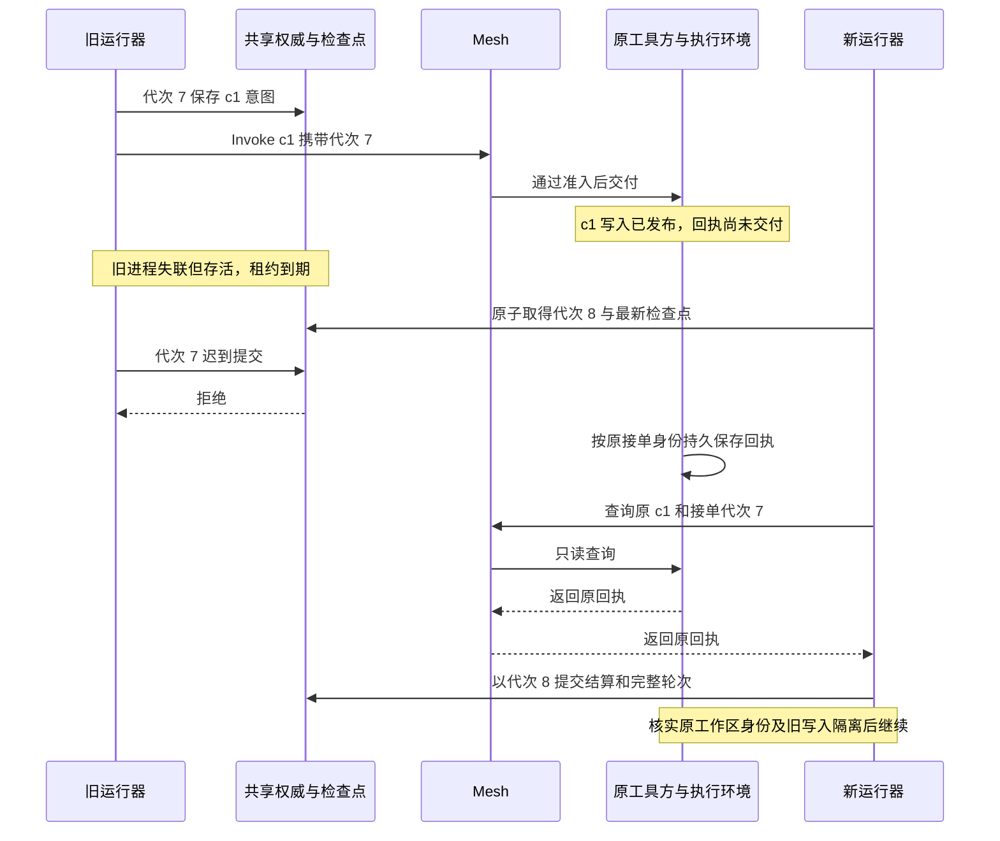

# 阶段 B · 运行器失联接管

## Context

已归档的本地重启依赖进程退出后释放文件锁。这一步验证另一种故障。旧进程仍活着，可能持有未提交结果、已排队请求或在途写入。首轮采用宿主显式触发接管、两个运行器和受控的 Mesh 断连。

[已归档的本地恢复规范](../../../specs/run-recovery/spec.md) · [工具回执生命周期](../../../../docs/specs/tool-call-lifecycle.md#阶段-b-恢复)

## Decisions

### 推进权和写入边界

共享状态按逻辑运行器、可信主体和 `RunID` 定位。记录包括持有实例、所有权代次、租约到期时间、检查点修订号及终态。所有权以共享权威的时钟和原子裁决为准。实例凭有效租约续租。到期后，接管请求只有一次能原子递增代次并取得最后已提交的检查点。多个运行器都可存活，只有当前未过期的实例可以推进。

| 边界 | 执行方 | 核验与拒绝行为 |
| --- | --- | --- |
| Run 状态提交 | 共享检查点 | 一次条件写入同时核验实例、代次、租约与预期修订号。旧进程即使知道最新修订号也不能写入。只有提交成功才可确认取消、结算或终态 |
| 模型和工具接单、环境授权 | Mesh 路由到具备准入检查的组件 | 根据可信实例身份、代次和已持久化意图，在接单处与接管原子排序。运行器在发送前做的检查无法覆盖队列延迟，接单处继续复核 |
| 工作区修改、产物发布 | 执行环境或产物存储 | 真正对外可见的发布操作与接管共享顺序。旧调用的临时数据按原代次隔离。旧句柄的清理只能影响该句柄绑定的资源 |
| 原回执保存 | 原工具提供方 | 按原接单记录保存幂等、有界的结果。旧进程的 Run 提交权过期后，提供方仍可记录已发生的效果 |

所有权代次是写入保护的一部分。首轮环境把写入放入代次隔离的暂存区，在同一受控提交边界内核验当前租约并发布。能直接改写保留工作区的旧文件描述符、挂载或后台进程会绕过该边界，此类环境不可用于接管验收。新运行器读取原检查点即可开始只读核对。依赖工作区的下一次派发须等待环境确认原工作区身份和旧写入已被隔离。

共享权威暂时不可达时，运行器可以停止本地在途工作。新派发、状态提交、工作区发布和确认终态均等待权威恢复，随后按原 Run 截止和原已受理的取消裁决。

### 已写入、原回执迟到

接单代次来自接单时保存的受信记录，当前代次描述谁能把结果写回 Run。两者分别核验。原提供方回执绑定原接单、请求指纹和工作区。当前运行器从原绑定查询，核对后按原 `CallID` 提交结算、配对顺序和下一步位置。重复回执以已提交账本裁决。

| 原调用状态 | 接管处理 |
| --- | --- |
| 完整批次已提交 | 直接从下一轮继续，使用已提交结果 |
| 已有工具意图，回执待核对 | 只查询原提供方。缺少记录、旧进程转发结果或文件存在均不能直接结算 |
| 可信回执证明已完成 | 使用原结果。工作区隔离通过且剩余额度允许时继续 |
| 可信回执证明未执行 | 原尝试已无法发布且能确认无既有可见效果时，提交原 `CallID` 对应的失败结果 |
| 仍未知或核对已结束 | 沿用已经持久化的核对期限。截止或已受理的取消触发 `ToolOutcomeUnknown`，提交终态后迟到回执只留作诊断 |

原模型派发意图存在但完整回复尚未提交时，沿用模型步骤中断语义。仅有完整工具批次且某项尚未记录工具意图时，当前运行器可以在工作区和权限检查后首次派发该项。

## Risks / Trade-offs

- 失联与进程退出无法等价。等待租约到期会增加接管延迟，换来按共享权威确定的唯一推进者。
- 权威不可用时，Run 暂停新的提交和派发。首轮用可控时钟和共享裁决组件测试该约束，生产部署拓扑与存储选型留在后续。
- 发布与回执分别保存。旧写入被隔离只能说明未来无法生效，已有工具效果仍需可信回执或明确的未执行证明。

### 本地装配

- 在 `RecoveryConfig.Takeover` 配置正数租约时长，在 `StartRequest` 同时开启 `Recoverable` 和 `Takeover`。宿主通过原 `RunID` 调用 `Recover`。首轮使用同一宿主的共享持久目录、短事务文件锁和宿主时钟。
- 文件写入使用 `NewLocalTakeoverEnvironment`、按次写权限及 `PublishToolFile`。托管接口对单一授权路径追加最多 64 KiB，不提供可长期持有的写句柄。进程内工具须通过托管接口产生对外效果。
- 产物发布依赖能跨进程保留引用且在 `Complete` 或 `Settle` 前只暂存的后端。可控双进程测试使用同一套 Mesh 和共享检查点路径。
