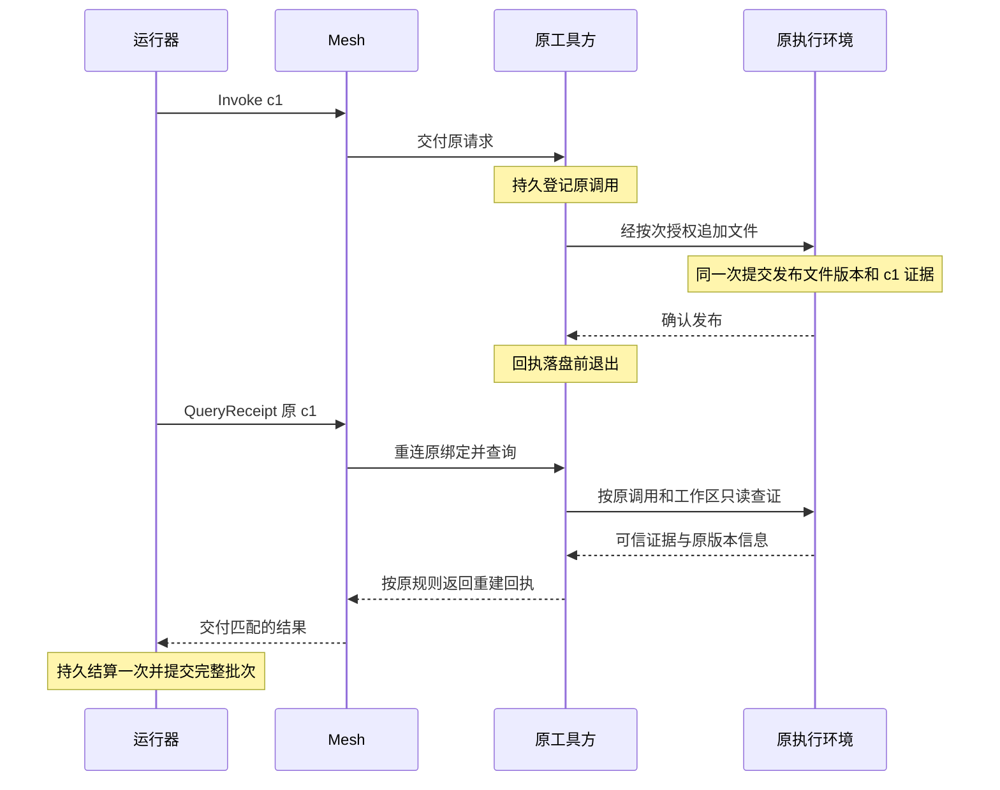

# 阶段 B · 用原写入证据重建回执

## Context

现有远程工具先写文件，再由工具方另行保存回执。两者之间退出时，这次写入可能已经可见，原回执仍处于待完成。这一步为显式启用证据的单次托管追加定义可核验的发布点。

[恢复主规范](../../specs/run-recovery/spec.md) · [工具调用生命周期](../../../docs/specs/tool-call-lifecycle.md#阶段-b-恢复) · [环境与保留策略](../../../docs/specs/execution-environment.md#工作区和产物保留)

## Decisions

### 执行环境保存什么

| 阶段 | 持久记录与读取边界 |
| --- | --- |
| 原调用接单 | 运行器的意图和工具方的接单记录固定原调用身份、授权路径、指纹、额度和回执规则版本 |
| 暂存 | 环境生成并持久保存不可变文件版本，同时计量长度与摘要。普通工作区读取仍解析到上一版本 |
| 发布 | 在同一原子提交中更新托管路径指向的版本，并登记与原 `CallID` 对应的写入证据。两项同时对读者可用 |
| 核对 | 环境按原调用键只读返回证据及原版本状态。工具方在原 `QueryReceipt` 路径核对并重建小回执 |

首轮把托管工作区的路径索引作为可见性的权威。发布只切换已持久化的版本引用，并在同一事务写入证据。即使环境进程在回复前退出，重新打开时也能得到一致的路径和证据。通过托管接口读取路径。普通文件追加完成后再另写一条日志，仍会留下文件已可见、证据缺失的窗口。

证据记录包含环境和工作区身份、原调用键、接单代次、指纹、操作类型、规范路径、追加内容摘要、基础版本、发布版本、内容哈希、字节数及证据引用。接管模式在原有写入隔离边界核验代次。发布前确认原路径版本及证据留存能力。相同发布只返回原版本，内容或路径冲突时拒绝。

保留期限在接单时固定，至少覆盖原 Run 截止和约定去重窗口中较晚者。撤销文件句柄或出现覆盖版本时，原证据与其引用仍可查询。回执和检查点持有小记录及引用，文件正文由环境保存。

### 首轮装配

- 宿主用 `NewLocalEvidenceEnvironment` 配置私有持久目录和 `MaxFileBytes`。托管读取经 `OpenRead` 解析已发布版本。原工作区的普通同名文件不参与证据核对。
- 远程绑定固定 `AppendFileEvidenceV1`。客户端用 `PrepareEvidenceAppend` 提取 `Path`，工具服务按 `Path`、`Content` 执行一次托管追加，并在接单时将 Run 截止加上 `EvidenceRetention` 固定为证据过期时间。
- 过期后证据查询拒绝交付。首轮由宿主管理持久目录的容量和回收，回收策略须保留当前版本和留存期内的原证据及版本。

### 文件发布后、回执保存前退出

### 谁能重建回执

| 原工具方观察 | 裁决 |
| --- | --- |
| 持久回执存在且匹配 | 返回原回执 |
| 原接单记录匹配、尚无已完成回执，且证据满足全部条件 | 使用接单时固定的规则重建已知成功回执 |
| 接单或回执记录无法读取、范围不符、证据或原版本不可信 | 回报不可确认，保持待核对 |

工具方核对原接单身份、工作区、指纹、目标路径与追加内容，再核实证据指向的是原提交的留存版本。首轮的工具协议保证一次托管追加就是完整业务效果。正常成功与重建共用固定版本的结果规则，从原发布版本得出路径、版本、字节数和摘要等必要结果。若有其他副作用、外部计算结果或字段依赖运行时观察，单条写入证据不足以证明整个工具结果。

`QueryReceipt` 查询和重建均只读。可以重复计算同一小回执。环境的已提交证据与原接单记录支撑重建，运行器把可信结果和证据引用随结算写入检查点。证据引用留在回执元数据中。查询不改变工作区、原回执库或原预算。规则须覆盖交给模型的每个必要字段，缺少可核实的结算用量时使用原预留。清理状态单独核验。

### 证据不足

到原绝对核对截止或显式取消仍没有可信回执时，运行器按原 `CallID` 提交 `ToolOutcomeUnknown`。路径存在、当前内容吻合或已暂存数据都只能作为诊断。已提交历史保留，未齐工具批次不进入下一轮，原调用不重发。终态提交后的证据也只进入留存或诊断。

## Risks / Trade-offs

- 原版本与证据需要跨进程留存。首轮只覆盖有界的单文件追加，正文与小回执分别持有。
- 旧版本可证明过去的效果。恢复后的工作区访问仍走既有身份和隔离检查，避免用过去的证据替代当前环境状态。
