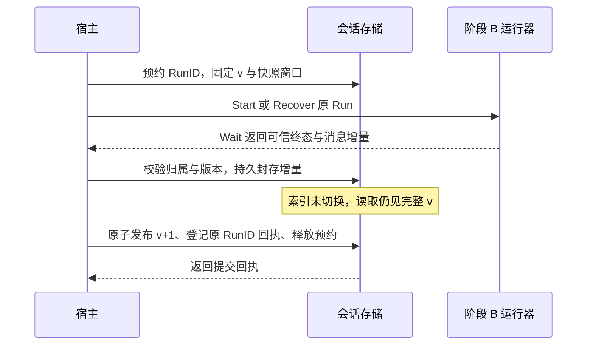

# 阶段 C 首步 · 本地会话设计

## Context

阶段 B 持有单次 Run 的受理、恢复和终态。会话层把 SDK 已确认的消息增量变为下一次 Run 可读的历史。现有消息、工具回执和产物引用沿用 A/B 的语义。 [消息组装](../../../../docs/specs/message-assembly.md) · [Run 恢复](../../../specs/run-recovery/spec.md)

## Goals / Non-Goals

首步采用同一宿主、同一本地存储跨进程接续。会话每次只处理一个待提交 Run，不同会话可同时推进。排队、公平调度、会话分叉、压缩接入和跨主机存储留到独立变更。

## Decisions

### 会话先固定输入，运行器负责执行

| 操作 | 读写边界 |
| --- | --- |
| 打开会话 | 从可信 SDK 绑定确定主体，用会话标识定位本地记录，并核对固定的逻辑运行器 |
| 启动 | 宿主在启动前取得由 SDK 按会话生成的不透明 `RunID`。会话先保存该标识、起始版本、历史窗口范围、固定的启动参数与归一化请求摘要，再发起可恢复 `Start` |
| 观察与取消 | 沿用该 Run 的句柄。会话层在释放会话锁后调用 SDK |
| 接续 | 从会话读出原待提交记录，使用同一 B 存储绑定，核对检查点身份及归一化请求摘要，再接续原 Run |
| 提交 | 入口只收会话与 `RunID`，由 SDK 获取可信终态。已发布回执可直接读取 |

会话范围和随机后缀共同生成 `RunID`，使同一主体和运行器下的会话能独立分配标识。以 C 预约和 B 检查点的身份与摘要共同确认归属。B 的 `Recover` 返回的“未找到”也用于终态过期。只有原权威存储确认初始记录从未提交，才按原请求和 `RunID` 走 B 的幂等受理。待提交 Run 的 B 记录须在原存储保留。来源、保留或内容不可验证时保留预约。

每个会话复用一个独立的短期进程锁，串行化待提交 Run 的受理尝试。持锁尝试须先核对预约仍有效。只有确认未受理且当前尝试已结束时，才清理该预约。进程退出时此锁释放，重启可沿原记录核对状态。

受理前持久记录“已尝试”。如果进程退出后该标记已存在且原检查点缺失，会话保留预约并报告结果不可用。原存储的持久身份用于识别同一路径上的替换。

### 本地索引决定哪条历史可见

| 记录 | 持久内容 |
| --- | --- |
| 会话索引 | 格式版本、会话归属、历史版本、最多一个待提交 Run，以及按 `RunID` 定位提交版本、文件和内容摘要的回执 |
| 每 Run 增量 | 原会话身份、`RunID`、起始版本、请求摘要、终态和规范消息。内容摘要覆盖终态及消息增量 |

用现有有界文件读写、跨进程文件锁和同目录原子替换。每会话的锁只包住有限的存储操作。发布顺序为同步增量文件及其目录，再替换索引并同步目录。重复提交先查回执，再校验版本，因而能在 B 的结果保留期之后重取回执。锁外等待终态后，重新检查回执和预约再提交。

索引是可见性的来源。封存前核对终态的 `RunID`、首条输入和完整消息形状。进程退出后，核验封存增量的身份、版本和请求摘要均匹配预约，同时重新校验内容摘要，再补做发布。索引已经发布时，重复请求返回原回执。写入确认不明时，重新读取并核验记录，确认同步完成后再回应成功。独立增量文件让提交只写一份新消息和有界索引，读取历史窗口只涉及选中的尾部增量。

### 容量与提交规则

- 会话配置限制可提交的 Run 数和每次启动的历史窗口字节数。受理前检查索引上限并预留一条回执。索引、单次增量及读取沿用本地记录上限。达到会话容量时明确拒绝新 Run，已提交历史和回执继续可读。
- 版本每次提交递增一次。成功、取消、失败及结果不明的已受理 Run 均使用 `Wait` 的增量。工具产物只保留可披露引用，正文由原产物存储保留。 [Run 增量边界](../../../../docs/specs/message-assembly.md#run-结束后交回宿主)
- 同一会话的冲突由索引锁和版本检查裁决。跨会话的取消和事件都走各自 Run 句柄。双会话验收预留模型和工具容量，验证会话层的独立性。

## Risks / Trade-offs

| 取舍 | 影响与处理 |
| --- | --- |
| 待提交 Run 占用该会话 | 宿主在保留期内提交，或用原 `RunID` 接续。若 B 结果过期且会话尚未封存增量，报告结果不可用并保留原历史 |
| 本地持久化依赖原存储 | 权威存储来源不明、损坏或写入失败时返回可区分的错误。恢复需验证原绑定；两块存储的写入由顺序和重试衔接 |
| 历史完整保留，输入窗口有界 | 启动时使用连续完整增量。最近的完整增量放不下时显式返回限额错误 |
