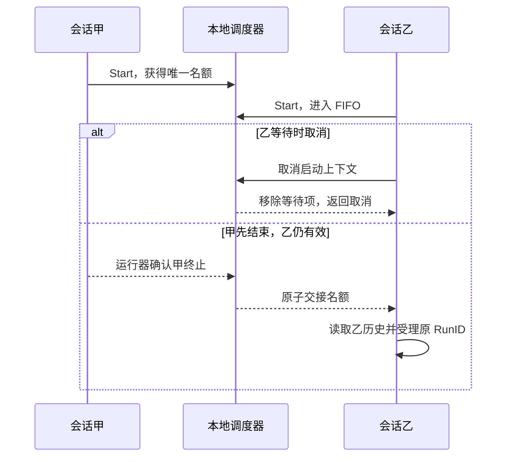

# 阶段 C · 本地调度设计

## Context

会话负责历史版本与单会话待提交位置。运行器负责 Run 受理、阶段 B 恢复和终态。会话容量、Run 预算与模型、工具、环境各自的资源限制沿用原契约。 [会话历史](../../../specs/session-history/spec.md) · [运行恢复](../../../specs/run-recovery/spec.md)

## Goals / Non-Goals

先支持一个本地 Mesh 装配进程内，多个会话争用同一逻辑运行器的容量。跨运行器公平、跨进程共享名额、持久排队、优先级和运行中抢占各自评审。

## Decisions

| 组件 | 职责 |
| --- | --- |
| 宿主 | 在逻辑运行器装配时配置 `MaxActiveRuns`、`MaxQueuedRuns`、`MaxQueueWait`。活跃上限为正，等待上限可为零，允许等待时等待时限为正 |
| 本地 Mesh 与调度器 | 每个受管逻辑运行器共享一个调度器。它维护 FIFO、计算等待期限、授予和归还名额。受管入口校验名额所属的主体、会话和 `RunID` |
| 会话 | 排队前核对主体与会话资格。授予后重验会话忙状态，按当时的已提交版本取得历史快照并记录持久预约 |
| 运行器 | 按已有契约受理与恢复。负责报告明确拒绝以及停止推进的结论，供调度器回收名额 |

与 SDK 兼容的入口沿用 `Session.Start(ctx)`。等待时保留固定的启动参数和取消状态，完整历史快照延后到受理。请求体受现有单条会话记录的字节上限预筛。相同 `RunID` 与请求的重试共享首次启动结果。重试者可结束自身等待，首次调用的上下文控制排队项。宿主排队期限在授予时结束，`Start` 的上下文继续约束受理，Run 执行预算从运行器受理时开始。

### 等待与交接

1. 入队、取消、过期、授予和释放在同一调度状态下裁决。队首失效时跳过，释放时先为下一条有效请求保留名额，再唤醒调用。会话读写和运行器调用在调度锁外执行。
2. 授予之后从受理开始计活跃。授予前取消直接移除。授予后沿用 `Start` 的受理结果，确认未受理时归还。已受理的 Run 通过原句柄或原 `RunID` 取消，普通等待与观察的上下文只结束各自调用。
3. 运行器的可信终止信号触发释放，历史提交独立进行。终态携带 `CleanupPending` 时，Run 名额随终态释放，执行环境按自身上限继续清理。受理状态模糊时保留原占用并核对原 `RunID`。

### 恢复与入口

未启用调度的绑定沿用既有启动方式。启用后，受管运行器对能够派发的 `Start` 或 `Recover` 校验调度授权，直接启动入口收到受理错误。读取既有结果及 `Observe`、`Wait`、`Cancel` 继续使用原 Run 句柄。已有活跃占用时恢复复用它。新进程恢复可推进的检查点时重新取得本地名额。

`CommitRun` 优先读已发布回执、封存增量或可信终态。只有需要恢复推进时才进入同一门禁。进程重启后，纯排队项由宿主显式重送。已进入受理的变更沿用原持久预约与检查点。

## Risks / Trade-offs

| 取舍 | 处理 |
| --- | --- |
| 受理或停止状态无法核实 | 保留原占用和归属，等待有权的运行器确认。等待者仍可取消或到期 |
| 一个长 Run 占用唯一名额 | Run 按自己的截止时间收尾，其他会话按独立等待期限排队。队列满直接返回 |
