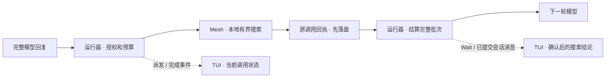

# TUI · 本地搜索设计

## Context

当前命令装配了 Anthropic Messages、会话和本地恢复。TUI 的工具事件只更新临时工具名，持久历史只显示工具名称。内建搜索已经具备有界读取和结构化结果。 [提案](proposal.md) · [搜索契约](../../../specs/bounded-file-search/spec.md)

## Goals / Non-Goals

- 使用同一个命令入口完成两轮模型、真实有界读、终态展示与跨进程核对。
- 搜索范围为显式根目录中的单个普通文件。目录遍历、shell、远程执行和写工具另行设计。

## Decisions

### 命令装配

```sh
superagent -model <模型ID> -state-dir <状态目录> -workspace <要检索的根目录>
```

| 层 | 职责与默认边界 |
| --- | --- |
| 命令 | 解析并核验实际工作区和状态目录，两者不可重叠，包含关系按规范路径和实际目录判断。仅显式开启时用 `NewLocalReadEnvironmentWithOptions`、`NewBoundedFileSearch` 和 `NewLocalReceiptTool` 装配 `search`，持久回执位于本次状态目录。模型用相对路径，宿主以 `.` 作为唯一读取前缀 |
| 运行器 | 新 Run 固定 `Environment` 和 `Tools`。工具尝试上限 2 次，扫描累计 1 MiB，沿用默认的 4 次模型请求、64 KiB 共享输出。按次额度取 Run 余额、工具上限及环境上限的最小值 |
| 搜索与环境 | 单次扫描最多 1 MiB，完整回执最多 16 KiB，复用现有查询、单行、命中及单条预览上限。共享读取活跃数跟随 `-parallel`，额外读取等待槽为 0；已受理 Run 内搜索串行 |
| TUI | 只保留有界事件和显示内容。沿用 `Tab`、`Esc`、`Enter` 和会话调度，不单独发起搜索 |

搜索的工作区绑定要能区分不同实际根目录。以规范根路径和现有环境可验证的目录身份生成稳定引用。跨进程只重开原目录与状态目录里的原日志，并沿用阶段 B 对权限、工作区版本和回执指纹的核验。命令继续识别原纯文本绑定，工具与环境仅在启用后的新请求上赋值。

### 观察与确认



| 证据 | 显示规则 |
| --- | --- |
| `tool.dispatched` | 显示「搜索中」，按会话、Run、调用标识归属。模型拟调用和文本增量本身不会创建进行中状态 |
| `tool.completed` | 用事件状态更新同一条目，例如「已结束 · 待确认」「已拒绝」「已失败」。事件只有状态码，报告等 `Wait` 或持久历史确认 |
| 已配对的 `ToolMessage` | 关联原助手调用。已知成功使用 `SearchReport`，显示工作区相对路径、覆盖、扫描字节、已返回命中数，最多展示 3 条现有的限长预览及行号。显示过滤控制字符。报告无法解码时仅显示有证据的状态 |
| 部分结果或失败 | 将 `scan_limit`、`line_limit`、`match_limit`、`preview_limit`、`result_limit` 映射成具体上限。已知部分结果保留实际扫描量和限长内容。明确未执行、读取失败、取消各自沿回执状态与原因显示 |
| Run 终态 | 用 `Wait` 的 `Outcome` 和可用的 `Stop` 标明 Run 预算耗尽、取消、超时或工具结果待核对。已提交的搜索条目保持可见。重进读回历史时用配对消息复原搜索报告，最新提交的 Run 可用 `SessionTurn.Outcome` 显示终态，不推断未持久化的停止详情 |

观察状态按调用覆盖更新，遇到终态以确认结果替换临时条目。终态前断流时继续已有的独立 `Wait`。显示消费有界报告，原始文件内容与原始工具参数不进入临时事件条目。

### 重进

| 原状态 | 新进程的处理 |
| --- | --- |
| 已有可信终态、封存增量或已发布历史 | 沿已有只保存链路或读取历史。由配对消息显示搜索结论，响应模型、查询工具及执行工具的新增次数均为 0 |
| 原 Run 仅有派发意图 | 先显示原 `RunID`，Enter 之后经调度与所有权门禁恢复。运行器经本地 Mesh 按原调用查询原回执，核对原主体、步骤、`CallID`、工作区、绑定及指纹，再使用原余额结算 |
| 工具结果和账本已经结算 | 从可信检查点使用原结论，从下一未完成步继续。原回执查询、执行及重复结算为 0 |
| 回执在核对截止时仍不可信 | 使用原期限和预算收尾到 `ToolOutcomeUnknown`。原工具及后续模型派发为 0，只保存此前已完成的消息增量 |

恢复后的终端等待可信 `Wait`，旧工具事件随原观察流结束。手动恢复的展示来自恢复状态和最终确认结果。 [Run 恢复](../../../specs/run-recovery/spec.md) · [会话恢复](../../../specs/session-history/spec.md)

## Risks / Trade-offs

- 大文件或连续命中会放大读量和显示量 → 分块、单行、回执、Run 和界面各自在已有边界内截住，验收同时记录实际读量与回执大小。
- 进程退出时回执可能已可读、账本尚未结算 → 使用原意图与持久回执核对。文件现状只用于新的授权读取。
- 换目录或替换原根后打开同一会话 → 原历史仍可读。继续动作重新验证原绑定，失败时回到待核对状态。

## Migration Plan

按需给现有启动命令加 `-workspace`。原搜索 Run 的恢复使用相同状态目录和原工作区。按纯文本模式启动仍可读已有历史。
