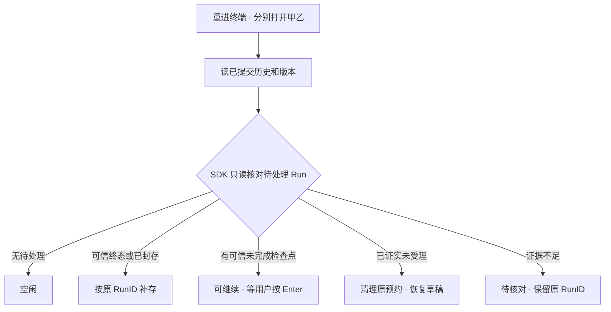

# TUI · 本地重进设计

## Context

当前 TUI 由 `Snapshot` 读取历史，由 `PendingRun` 知道是否有待提交 ID。现有 `Recover` 和 `CommitRun` 在一些路径上会触发推进。重进时需要先向 SDK 只读查询原状态，再选择受限动作。 [会话历史](../../../specs/session-history/spec.md) · [Run 恢复](../../../specs/run-recovery/spec.md)

## Goals / Non-Goals

覆盖同一宿主、原状态目录和两个 `SessionID` 的进程重启。另行评审跨主机界面恢复、持久草稿和观察流重放。

## Decisions

### 启动先读历史，再认领动作

两条会话从各自的 `Session.Snapshot` 读有界历史窗口。已提交版本和完整轮次仍由会话存储持有。按 `SessionID` 分别加载、核对、显示，`Tab` 继续只切视图。单边读取失败时保留该边可确认的历史与错误状态，另一边照常操作。

| SDK 路径 | 裁决 |
| --- | --- |
| 只读检查 | 核对原主体、会话、逻辑运行器、预约和请求摘要。原存储身份缺失时保留待核对 |
| 只保存 | 优先使用已发布回执或可信封存增量，其次使用可验证且未过期的 B 终态。按原 `RunID` 重试 |
| 只继续 | 用原 `RunID` 走已有调度和阶段 B 恢复。取得名额后重新校验；原进程仍有推进权时显示占用 |
| 清理未受理预约 | 持有原会话受理锁，复核原存储可信、原预约未标记尝试且原检查点不存在，按原 ID 清理。已保存的输入返回当前终端草稿 |

只读检查和写入前复核复用阶段 B/C 现有证据。原有 SDK 调用保持其行为，TUI 通过受限路径把查证、只保存和继续区分开。继续使用原截止和预算，等待恢复名额不会增加执行额度。旧模型流在完整回复前中断，按阶段 B 的原规则收尾。恢复后的旧 Run 用 `Wait` 显示可信结果，后续新 Run 使用现有流式观察。 [调度门禁](../../../specs/local-session-scheduling/spec.md)

### 退出按受理边界收尾

`Ctrl+D` 停止接收新操作，撤回当前进程内的启动和恢复等待。用短退出窗口确认撤回结果，并允许已知终态的保存完成。退出请求与 `Esc` 使用独立语义，原来已受理的停止请求由阶段 B 持久记录。

| 退出时的位置 | 下次显示 |
| --- | --- |
| 新请求仍纯排队 | 等待项和输入随旧进程结束。正常退出前提示未发送 |
| 取得名额，只有存疑的受理记录 | 重新检查，按上表裁决。退出窗口超时仍保留证据 |
| 已受理、运行中或已给出可信终态 | 保留原检查点或补存增量。进入后显示继续、保存或待核对 |
| 原 Run 正等待继续名额 | 撤回此次等待，原检查点仍属于同一 Run。重进后重新检查 |

## Risks / Trade-offs

| 情形 | 处理 |
| --- | --- |
| 退出窗口耗尽或进程被强制关闭 | 重进从两条会话的持久记录重新核对。队列始终随进程重建 |
| 原结果过期、证据损坏或被替换 | 已封存增量可补存，证据不足的预约保持待核对 |
